# DeepGIS-XR

**Demo clip:** 

<a href="https://www.youtube.com/watch?v=Plk7JyJsY7Y" target="_blank" rel="noopener noreferrer">
  
</a>

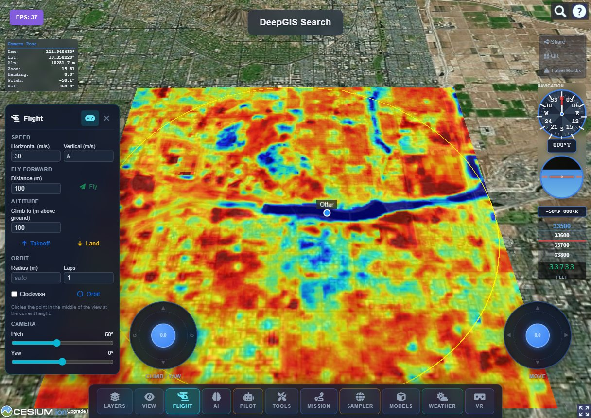

*The Earth viewer on deepgis.org, November 2026: Landsat 9 surface temperature
within 5 km of Tempe Town Lake, the **Flight** panel (speed, fly forward,
takeoff and land, orbit, camera pitch and yaw, joystick toggle), the virtual
joysticks, the camera pose and the shared toolbar. The blue pin is the otter
digital twin's live position.*

**Data layers at a glance.** Each view below was produced by one
plain-language request to the AI Pilot on deepgis.org; the chat lists the
readings, the legend and the sources. Click a picture for full size.

<table>
<tr>
<td width="50%"><a href="docs/images/hud/layer-surface-temp-phoenix.jpg">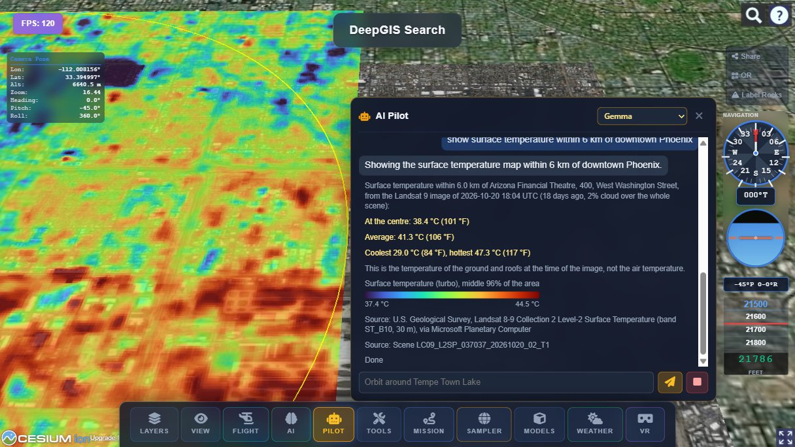</a><br><b>Surface temperature · Phoenix</b><br><i>"show surface temperature within 6 km of downtown Phoenix"</i> — Landsat 9 Collection 2 land surface temperature (<code>surface_temp</code>, turbo), 37 to 45 °C across the middle 96% of the circle; roofs and pavement hot, parks and the river cool.</td>
<td width="50%"><a href="docs/images/hud/layer-ndvi-yuma.jpg">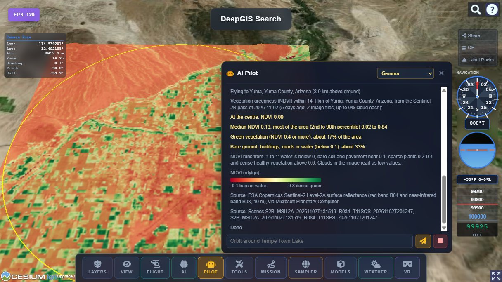</a><br><b>Vegetation (NDVI) · Yuma</b><br><i>"fly to Yuma at 8000 m and show NDVI"</i> — Sentinel-2 L2A red and near-infrared bands at 10 m (<code>ndvi</code>, red-yellow-green); irrigated fields along the Colorado River against bare desert, with the share of green, bare and water pixels.</td>
</tr>
<tr>
<td><a href="docs/images/hud/layer-elevation-grand-canyon.jpg">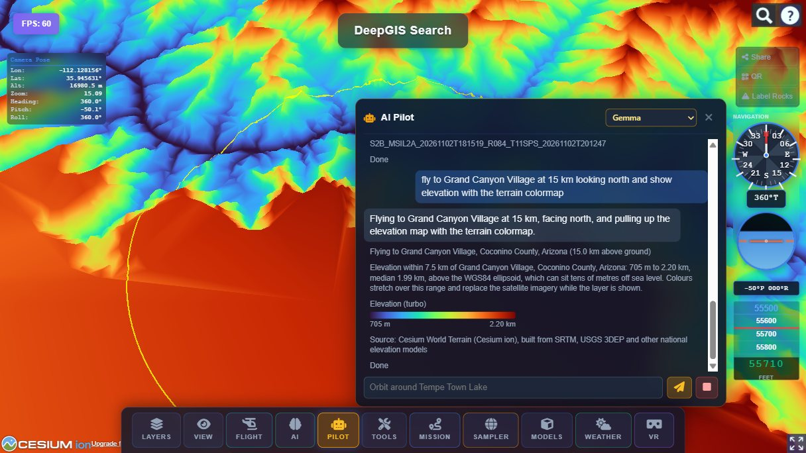</a><br><b>Elevation · Grand Canyon</b><br><i>"fly to Grand Canyon Village at 15 km and show elevation"</i> — Cesium World Terrain sampled within 7.5 km and stretched from 705 m to 2.2 km (<code>elevation</code>, turbo); the ramp replaces the satellite imagery while shown.</td>
<td><a href="docs/images/hud/layer-lidar-volcanic-tablelands.jpg">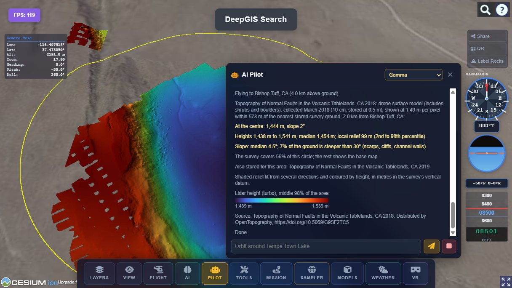</a><br><b>Lidar terrain · Volcanic Tablelands</b><br><i>"show lidar terrain at the Volcanic Tablelands"</i> — a 2018 OpenTopography drone survey stored on the server (<code>lidar_dem</code>): multi-directional shaded relief coloured by height, with slope and relief statistics for the normal-fault scarps north of Bishop.</td>
</tr>
<tr>
<td><a href="docs/images/hud/layer-faults-owens-valley.jpg">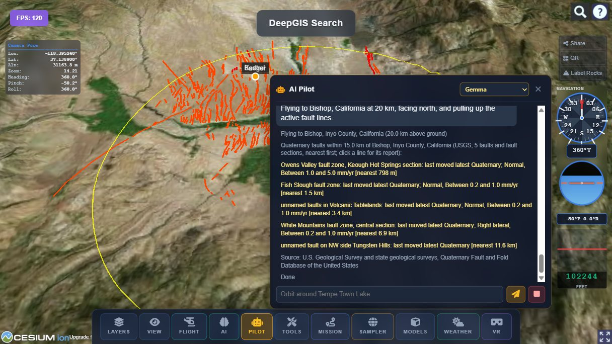</a><br><b>Quaternary faults · Owens Valley</b><br><i>"fly to Bishop at 20 km and show the faults"</i> — USGS Quaternary Fault and Fold Database (<code>faults</code>) within 15 km: the Owens Valley, Fish Slough and White Mountains fault zones with age and slip rate; the badger twin marker sits in the valley.</td>
<td><a href="docs/images/hud/layer-bishop-rock-survey.jpg">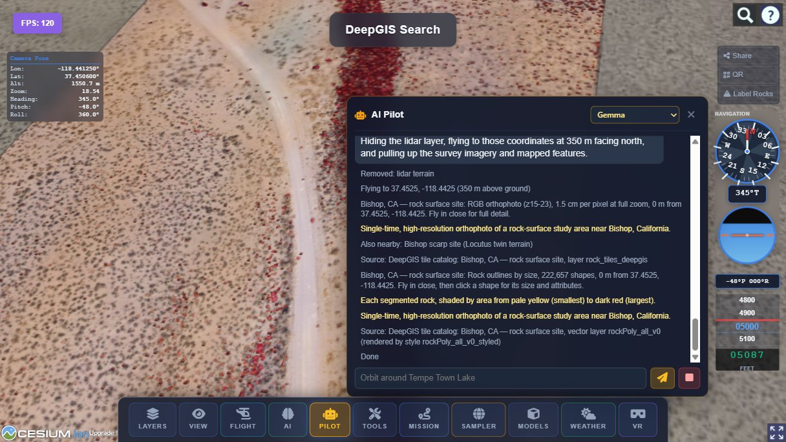</a><br><b>Survey imagery and features · Bishop rock site</b><br><i>"show the survey imagery and the mapped survey features"</i> — the lab orthophoto at 1.5 cm per pixel (<code>site_imagery</code>) with 222,657 segmented rock outlines shaded by area (<code>site_features</code>), both from the DeepGIS tile catalog.</td>
</tr>
<tr>
<td><a href="docs/images/hud/layer-geology-grand-canyon.jpg">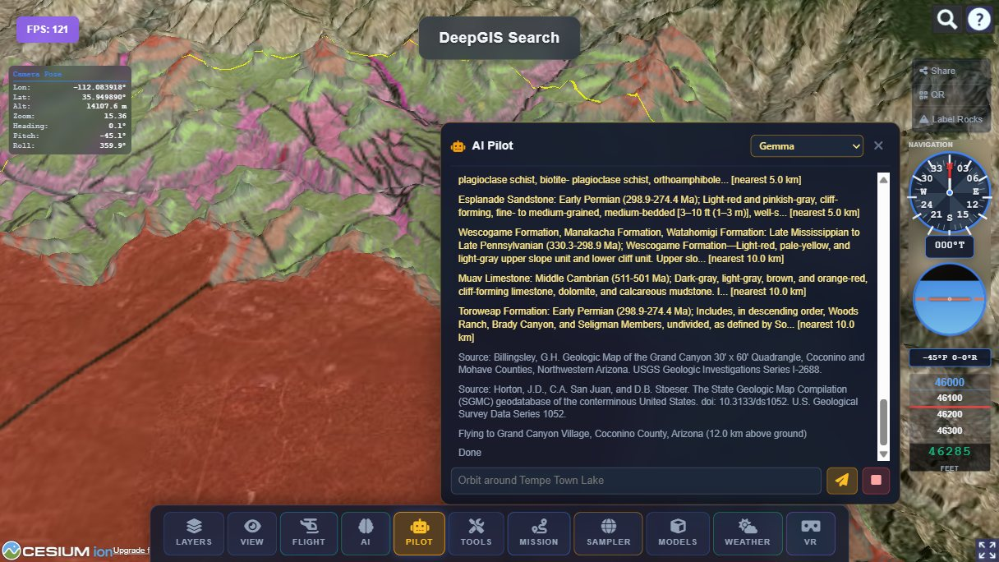</a><br><b>Geology · Grand Canyon</b><br><i>"show the geology within 10 km"</i> — Macrostrat map units draped at 55% (<code>geology</code>), each listed with age, lithology and the source map citation (Billingsley 2000; SGMC).</td>
<td><a href="docs/images/hud/layer-moon-tycho-elevation.jpg">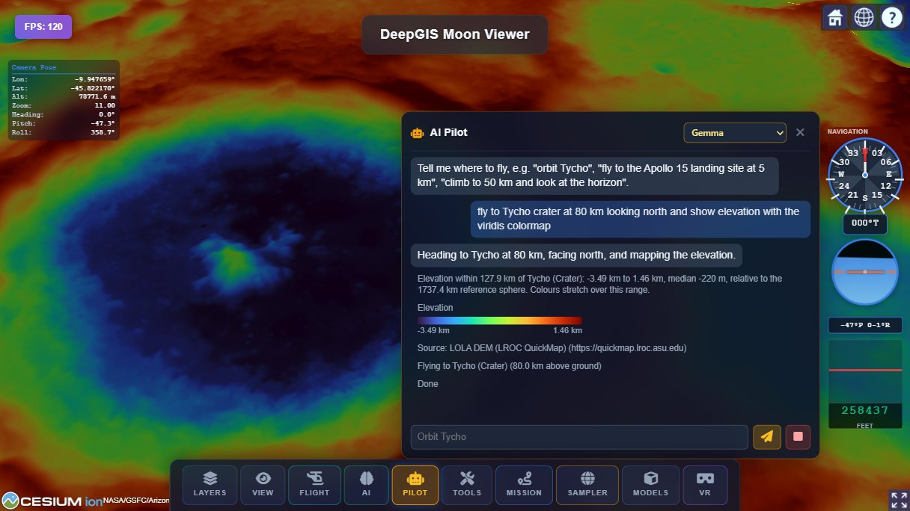</a><br><b>Elevation · Tycho, the Moon</b><br><i>"fly to Tycho crater at 80 km and show elevation"</i> on <code>/label/3d/moon/</code> — LOLA DEM heights from −3.49 km to 1.46 km around the crater and its central peak (<code>elevation</code>); the same HUD, Flight panel and pilot as on Earth.</td>
</tr>
</table>

**Geospatial visualization platform with AI-powered analysis and a language-driven camera drone**

[](LICENSE)
[](https://www.python.org/)
[](https://www.djangoproject.com/)
[](https://cesium.com/)

DeepGIS-XR is a geospatial visualization and analysis platform for Earth, the
Moon and ten other planetary bodies. It combines a CesiumJS 3D globe,
open-vocabulary AI detection and segmentation of the current view, adaptive
spatial sampling, a curated tile catalog, and an AI pilot that flies the camera
and draws sourced data layers from plain-language requests. Every globe shares
the same HUD, camera drone and pilot.

Live viewers: [Earth](https://deepgis.org/label/3d/search/) ·
[Moon](https://deepgis.org/label/3d/moon/) ·
[Mars](https://deepgis.org/label/3d/planet/mars/) and the other bodies at
`/label/3d/planet/<body>/`.

---

## 🌟 Key Features

### 🧑‍✈️ AI Pilot (new, October 2026)
A **Pilot** panel on every globe turns requests into camera-drone flights and
data layers:

- *"orbit around Tempe Town Lake"*
- *"fly to Hayden Library at 200 m, orbit it twice clockwise, then land"*
- *"climb to 1500 m and look at the horizon"*
- *"orbit around Hayden Butte and show geologic features within 5 km"*
- *"show active faults near Bishop"*
- *"trace the Salt River downstream and show live flow"*
- *"orbit all of Tempe and show surface temperature as a jet colormap"*
- *"sea surface temperature of Monterey Bay"*
- *"show the lidar of the Volcanic Tablelands fault scarps"*
- on the Moon: *"orbit Tycho and show elevation as a colormap"*
- on any globe: *"do a visual analysis of the viewport camera scene and list
  what you observe"*
- on Earth: *"sync the view with the OpenUAV sim camera"*, *"chase kestrel"*,
  *"what robots are nearby?"*, *"orbit the Locutus world"*

A language model only chooses the actions and the numbers the user gave
(`goto`, `orbit`, `takeoff`, `land`, `look`, `stop`, `wait`, `show_layer`,
`hide_layer`, `describe_view`, `find_objects`, `show_scene_graphs`,
`world_uncertain`, `world_confidence`, `capture_quality`, `world_changes`,
`follow_vehicle`). Django validates and clamps
them, and the page runs them on the existing drone controls. These actions
never touch a vehicle.

Superusers can also command the lab's robots (the PX4 digital twins) from
the same chat, for example *"kestrel, take off and survey a 40 m square at
15 m"*, *"drive the rover 10 m north and let me watch"* or *"send kestrel
home"*. The model proposes a `robot_command`, and the chat shows it as a
card. Nothing is sent until you press **Send**. **Preview plan** asks the
robot's mission supervisor for the plan without flying it. See
[Robot commands](#robot-commands-superusers).
`describe_view` sends one frame of the 3D view to the lab's vision model,
which returns a summary and a list of what it sees. `find_objects` runs
SAM 3 on the view for the objects named (*"show me buildings and houses
with a histogram"*) and posts their count, area statistics and an area
histogram in the chat. `show_scene_graphs` lists the stored world-model
captures in view; clicking one draws its objects and links and flies to
it. Four more questions go to the world model for the area in view:
*"what's uncertain here?"* (`world_uncertain`: how many objects are
*unknown*, what each most likely is, and how confidence is spread),
*"show only confident objects"* (`world_confidence`, 50% by default; *"show
all objects"* clears it), *"how sharp were the captures here?"*
(`capture_quality`: cm per pixel, the smallest object each capture could
resolve, and how well its camera position is known) and *"what changed here
since April?"* (`world_changes`: objects first seen since then in green,
objects later captures missed and that are now believed gone in red).
Superusers can also click a world-model object and say *"remove that
blob"* (`retire_entity`): the chat asks for confirmation, retires it
(nothing is deleted) and offers **Undo**. `follow_vehicle` locks
the view to a live vehicle (see [Live vehicles](#-live-vehicles)). Off Earth the
pilot resolves IAU feature names from the USGS Gazetteer of Planetary
Nomenclature and flies at orbiter scale. See
[AI Pilot architecture](#-ai-pilot-architecture).

### 🗺️ Data layers
`show_layer {kind, place, radius_m, colormap}` draws a layer around a place,
lists or summarises what is there in the chat, and cites the source. Every
kind runs through the same steps: fetch from a public source, list, draw,
cite, and hide on request. Layers of different kinds stack.

**Features** (Earth):

| kind | Example request | Source | Coverage |
|---|---|---|---|
| `geology` | "geology around Griffith Park, Los Angeles" | [Macrostrat](https://macrostrat.org/) map units and tiles, plus curated Tempe-area sites | Worldwide, most detailed in the US |
| `faults` | "show active faults near Bishop" | USGS Quaternary Fault and Fold Database | US |
| `flood` | "flood risk around Tempe Town Lake" | FEMA National Flood Hazard Layer | US |
| `fires` | "past fire perimeters within 20 km" | NIFC InterAgency Fire Perimeter History | US |
| `river` | "trace the Salt River downstream and show live flow" | USGS NLDI (NHDPlus) and NWIS live discharge | US |
| `landcover` | "land cover within 5 km" | NLCD 2021 (MRLC) | Contiguous US |
| `soils` | "what soils are under this field?" | USDA NRCS SSURGO via Soil Data Access | US |
| `wildlife` | "wildlife observations around Papago Park" | iNaturalist research-grade observations | Worldwide |
| `trails`, `springs`, `mines` | "trails, springs and mines within 3 km" | OpenStreetMap via Overpass | Worldwide |

**Colour maps** (Earth). Drawn with a legend and readouts in the chat
(centre value, typical range, extremes). Name a colour map to change it:
`jet`, `turbo`, `viridis`, `inferno`, `plasma`, `coolwarm` or `rdylgn`
("rainbow" means jet). By default these cover the whole place; layer radii
may reach 200 km.

| kind | Example request | Source | Coverage |
|---|---|---|---|
| `surface_temp` | "surface temperature over Tempe in jet" | USGS Landsat 8/9 Collection 2 Level-2 surface temperature (30 m), newest clear scene, via Microsoft Planetary Computer | Worldwide land |
| `ndvi` | "how green is Phoenix?" | Copernicus Sentinel-2 L2A NDVI (10 m), every tile of the newest clear pass, via Microsoft Planetary Computer | Worldwide land |
| `humidity`, `air_temp` | "what's the humidity around Tucson" | Open-Meteo current conditions on a 7 × 7 grid | Worldwide |
| `sea_temp` | "sea surface temperature of Monterey Bay" | NASA JPL MUR SST v4.1 (1 km, daily) from NOAA CoastWatch ERDDAP | Global ocean |
| `chlorophyll` | "chlorophyll off Santa Cruz" | NOAA gap-filled VIIRS + OLCI chlorophyll-a (2 km) from NOAA CoastWatch ERDDAP | Global ocean |

**Terrain** (Earth):

| kind | Example request | Source | Coverage |
|---|---|---|---|
| `elevation`, `slope`, `contours` | "Mount Whitney elevation in viridis, then slope and contours" | Cesium World Terrain, coloured on the globe (heights above the WGS84 ellipsoid) | Worldwide |
| `topo_datasets` | "what OpenTopography data is near Bishop?" | OpenTopography catalog: survey footprints and links, with surveys stored on DeepGIS marked | Worldwide |
| `lidar_dem` | "show the lidar of the Volcanic Tablelands" | OpenTopography surveys stored on the server (0.5–1 m): shaded relief coloured by height, with relief and slope figures | Bishop, California area (five surveys) |

**Other bodies.** On the Moon, `elevation`, `slope` and `contours` colour the
globe from the LOLA terrain. Mars and Pluto offer `elevation` from their
colour elevation maps. The remaining bodies have no layers yet.

The two ocean layers and `lidar_dem` are fetched through Django
(see [API endpoints](#-api-endpoints)); every other layer is fetched by the
browser from the public source, with no API keys.

The curated geology sites around Phoenix and Tempe (Tempe/Hayden Butte, Papago
and Barnes Buttes, Hole-in-the-Rock, Camelback Mountain, South Mountains,
Superstition Mountains, Tempe Town Lake) have descriptions sourced from
Arizona Geological Survey publications and others, plus OpenStreetMap
coordinates, in `staticfiles/web/geo/tempe-geology.geojson`.

### 🤖 AI Viewport Analysis
Analyze what the camera sees with one of four models:

- **Segment Anything (SAM)**: prompt-free segmentation of every region in the
  view, with GeoJSON export and polygon simplification. Remote service, with
  a local fallback in the web container when the service is unreachable.
- **YOLO26 / YOLOE-26 / SAM 3** (one panel option, served by
  `services/ultralytics-api/`): YOLO26 segments the 80 COCO classes, with an
  optional class filter; YOLOE-26 finds the classes you list; SAM 3 returns
  masks for text prompts such as `building, tree, car`, at about 30 s a call.
  SAM 3's weights are gated on Hugging Face, so the service reports
  `weights_missing` until `sam3.pt` is in its weights folder.
- **Grounding DINO**: open-vocabulary detection from a text prompt, e.g.
  `"rock . boulder . crater . debris"`. Suited to domain-specific targets
  (geology, archaeology, agriculture). Remote service.
- **Mask R-CNN rocks** (Earth only): rock instance segmentation from the
  Bishop/Jezero checkpoints. Remote service.

Results come back as GeoJSON, drawn on the globe with labels and confidences:
clamped to the terrain in 3D, flat with outlines in 2D. Degenerate rings are
dropped before drawing, and if a frame still fails the page clears the AI
overlay and keeps rendering.
On Earth, the **SceneGraph** button runs several of these (Mask R-CNN rocks,
Grounding DINO, SAM, SAM 3, YOLO) on the same frame and fuses them with OSM
buildings and roads into one labelled graph. Builds that include SAM 3 or YOLO
use the `urban_v1` categories, which add house, pool, parking lot and solar
panel to building, road, vehicle, tree, grass, pavement, water and so on; the
SAM 3 prompts are editable in the panel. Each object is drawn as a polygon
coloured by its most likely category, more opaque the surer the fusion is,
with an outline that thickens with the number of models that found it; the
strongest links between neighbouring objects are drawn as lines. *Show scene
graph* and *Links* toggle them. The AI overlays are hidden while a frame is
captured, so the models never see earlier results.

### 🧭 World model: a spatiotemporal scene graph
When the observations database is configured, every SceneGraph build is also
folded into a persistent world model in PostGIS (`deepgis_xr/apps/scene_store`):
- **What was seen**: each capture (footprint, time, camera pose), the kernels
  that ran, their detections and each kernel's raw claims.
- **What is there**: entities, one per world object, matched across captures
  by overlap (or by centroid distance for small objects such as cars).
- **Factors as rows**: perceptual, existence (hit / miss), context
  (co-occurrence of neighbours) and containment (a solar panel on a roof, a car
  in a parking lot) factors, each with a valid-time range and recorded /
  superseded times, so corrections never erase history.
- **Time**: an entity's category is fixed, but its existence is a chain that
  forgets at a rate set by the category (hours for cars, years for buildings).
  The store can answer "what was here at time *t*" and notices a car that left.
- **Incremental inference**: a new capture re-runs belief propagation only on
  the entities it touched; a 70-object capture is stored in about a second.
- **Feedback and preferences**: signed-in users can confirm, relabel or reject
  an entity; the correction becomes a strong factor and is counted per source
  as a signal for recalibrating the kernels. Per-user settings are kept too.

In the AI panel, *World model* draws the remembered objects in view, faded by
how likely each one is still there, now or at a chosen time ahead (in 12
hours, in a week). Clicking one shows its category, sightings, misses and
models, with *Correct*, *Relabel* and *Not there* buttons for signed-in users.
The panel also remembers each user's model, prompts and scene-graph models.

`python manage.py ingest_scene_graphs` replays stored SceneGraphs into the
world model (`--reset` to rebuild it).

Geometry keeps the world model honest about what a camera can see:
- Each capture stores its camera pose with an uncertainty (`Pose`; the 3D
  globe's camera is exact, so the error is the imagery's registration) and
  its ground sample distance. A miss only counts for an object at least 64
  pixels across at that resolution.
- A region covering more than half of the capture is the frame, not an
  object: it is stored but never becomes evidence.
- Every other region gets a `geometry` factor: its ground area against
  each category's plausible range (a 3,600 m² "car" is pushed away from
  vehicle), and large compact "roads" are penalised as blobs.
- An entity whose most likely category is under 25% is shown as *unknown*;
  the API's `best_guess` and the panel keep the top category and its
  probability (most unlabelled OSM and plain SAM regions sit at 10-20%).
- `python manage.py retire_entities` takes entities out of the world
  model by id or by rule (category, area, compactness, first-seen dates,
  source) without deleting them; `--restore` undoes it. Without `--apply`
  it only reports. `apply_geometry_priors` brings stored evidence under
  these rules (dry run unless `--apply`; `--misses-only` for just the
  resolution check).

Three more rules tie the beliefs to what was measured:
- **Two clocks.** A capture records when it was viewed and, separately, when
  its imagery was acquired. For Bing aerial imagery the page asks the
  provider for the acquisition window of the tiles on screen and sends it
  with the build (`viewport.imagery`: `source`, `layers`, `dates`); the
  middle of the window dates the capture's detections and factors. A stored
  belief is *as last seen*: nothing decays after an entity's newest
  evidence, and `at=` (the info box's *Still there today*) decays it to a
  chosen time. `world/changes` compares imagery dates by default and says so
  when every capture in the area shows the same imagery, so looking at one
  image twice is not reported as change. `backfill_imagery --file
  dates.json` dates captures that were stored without one.
- **A measured detection model.** How much a miss counts depends on how
  likely the detector was to find that object: a logistic model of the
  object's size in pixels, the zoom relative to its first sighting and its
  category, fitted to the store's own repeat looks and cross-validated by
  capture (`fit_detection_model`; kept in `sg_detection_model`). On the
  Tempe captures it halved the held-out log loss of the fixed 0.8 it
  replaces (0.45 against 0.94). A detection smaller than 64 image pixels is
  a fragment: stored, never evidence (`gate_fragments` applies that to
  detections already stored).
- **Truth from people and from the field.** The info box of a clicked object
  carries *Correct*, *Relabel* and *Not there* for signed-in users, and
  *Review next* in the AI panel walks the objects in view whose answer would
  tell the model most (category plus existence entropy, in bits), flying to
  each. A correction is dated by the imagery it was made on. A field robot's
  reading is registered to the entity under its laser target, weighted by
  the share of the target's position uncertainty that falls inside the
  outline; its daylight NIR/red index then counts as weak evidence for or
  against vegetation, one vote per entity, robot and day
  (`register_field_readings`; new readings register as they arrive). Which
  entities a robot has read is shown to signed-in users only.
- **Evidence that does not depend on the order captures arrive.** A miss
  used to be recorded only when a capture failed to re-find an object the
  store already had. An object first found on ground that an earlier capture
  had already resolved now also carries that earlier capture's miss,
  weighted by the fitted chance that capture would have found it, so
  "looked, then found" and "found, then looked" leave the same evidence.
  Every detection is tagged with why it is there: `new_ground`,
  `newly_resolvable` (covered before, too coarse to resolve it), `re_found`
  (covered and resolvable before, not found), `relook_finer` or
  `relook_same`. `backfill_causes` applies both to captures already stored.
  On the Tempe captures 2,853 of 7,108 first sightings were re-found. Their
  P(exists) starts at a median 0.888 against the 0.892 of new ground: the
  fitted model gives the earlier, mostly coarser looks a median 10% chance
  of a find, so their misses weigh little.

These five commands only report unless `--apply` is given.

**Looks: the captures of one image count once.** The basemap serves one
imagery vintage however often it is viewed, and a detector run again on the
same pixels repeats its own mistakes: on the Tempe captures, repeated
detections of one object named the same top category in 95% of pairs.
Multiplying them in as separate observations made beliefs surer with every
capture and no new information. `scene_store/looks.py` puts one hidden
variable per object and image between the two:

    world (exists, category)  --  what the image shows  --  detection 1, 2, ...

- Detections are evidence about the image; only the image is evidence about
  the world, and one image can be trusted only so far (two hand-set numbers
  in `priors.py`: it shows an object that is not there 5% of the time and
  hides one that is there 10%). The hidden variable is summed out at
  inference time, so each look sends the object one message. More captures
  of one image raise P(exists) toward 0.947 and no further; a second image,
  a correction or a field reading is what moves it beyond. A single
  detection is doubted twice, by the detector and by the image, and gives
  0.89.
- For the category, detections that agree are one reading, not their
  product; detections that disagree become a mixture weighted by how many
  back each reading.
- Stored factors are untouched: the grouping comes from each factor's
  capture and its imagery record. A capture whose imagery is not identified
  is a look of its own. `python manage.py rerun_beliefs` recomputes stored
  beliefs when the rule changes (dry run unless `--apply`; it also reports
  what counting every detection would give).
- An object's `support` (API, MCP, the info box's *Evidence* row) lists its
  looks: captures, times found and missed, and what that image says alone.

**A fused assessment at any point.** `world/assess?lon=&lat=` (MCP
`assess_point`) answers "what is here, and on how much evidence" for a point
rather than an object. Each stored object covers the point by the share of
the point's position uncertainty inside its outline (2.5 m by default; a
robot passes its own) times its P(exists). Objects are composed front to
back, smallest on top, as an aerial view shows them, giving each a share of
the answer; the result is a category distribution plus `no_object`, the
chance that nothing stored accounts for the point. `looked_at` tells
"captured and found empty" from "never captured", and `at=` decays the
beliefs to a date.

**What a capture was worth, and which to take next.** Every capture's
record carries a `reward` (`world/captures`, MCP `list_scene_graphs`): the
category entropy it removed, in bits, split by cause. `bits_new` is the part
that came from pixels the store had not read: new ground, newly resolvable
objects, finer re-looks, and a re-found object's bits scaled by the chance
that no earlier look would have found it. `bits_reread` is the rest. The
record also has the hectares of the footprint that were new, finer or the
same as before, and the share of first sightings that were on new ground.

`scene_store/sampler.py` turns those rewards into a choice. The arms are
100 m cells crossed with five ground-sample-distance bands (0.12 to 1 m).
An arm's expected `bits_new` is a per-band yield for new, finer and
already-read ground (Bayesian linear regression on the stored rewards,
shrunk to the all-band fit), times the shares of the arm's footprint in
each class, times a smoothed factor for how nearby captures did against
that expectation. `POST world/next_view` draws the yields and the place
factors from their posteriors and returns the best arm (Thompson sampling;
`policy=uniform` picks a random arm, `greedy` the posterior mean). The
proposal is stored with its prediction, and `POST world/pulls` attaches the
capture that answered it, so predicted and realised sit side by side
(`GET world/pulls`, MCP `sampler_pulls`). `hud/sampler-loop.js` runs the
loop on the search page with the map in 2D:
`samplerLoop.run({n: 30, policies: ['thompson', 'uniform'], run: 'label'})`
in the console. The page has to be on screen; a hidden tab stops drawing
frames and the capture waits on them.

On its first run over Tempe (30 captures per policy, taking turns) the
sampler's captures returned 220 new bits each against 238 predicted and
were 99.8% new ground. Captures at a random cell and band returned 90
against 84 predicted; 58% of their first sightings were new ground and 27%
re-found. Across all 60, predicted and realised correlate at 0.78. The
sampler stayed in the 0.2 m band throughout: the gain came from knowing
what is already covered and which zoom pays, and its misses were places
with few objects, which the place factor does not yet foresee.

**The latest fused map of a zone, to download.** A *zone* is a named area
(`python manage.py add_zone az/tempe --name "Tempe, Arizona" --census-place
0473000`, or `--bbox=`, or `--geojson`). Its map is the point assessment
worked out for every 2 m cell (`scene_store/zonemap.py`): a cell takes the
colour of its most likely category, stronger the likelier a stored object
accounts for it, over a public aerial photograph of about the imagery's
date (NAIP; the basemap the objects were found on is not redistributed).
One page carries the map; a legend with the objects, hectares and label
confidence of each category; what the map rests on (captures, distinct
images, corrections); and three small maps of the evidence: how sure the
label is, how often and how finely the ground was viewed. Ground that was
viewed and holds no object is drawn apart from ground no capture has looked
at. `/world-model/zones/<slug>` shows the page, with `.pdf`, `.png`, `.jpg`
and `.json` beside it, and `/world-model/` lists the zones.
`python manage.py render_zone_maps` draws a zone again only when its
entities, captures or corrections have changed, so running it every few
minutes keeps the published map the latest; no web request draws anything.
The files are kept under `<OBSERVATIONS_ROOT>/maps/zones/<slug>/`.

**Remote sensing over each object.** The pilot's map layers are drawn in the
browser and kept nowhere. `scene_store/layers.py` keeps the same kind of data
per object: every Sentinel-2 pass, NAIP aerial photograph and lidar survey
over a capture area is stored as a scene with its own acquisition time, and
sampled onto each entity it can resolve.

- **A sample knows how much of it is the object.** A 10 m pixel over a
  house is mostly the yard. The outline is drawn on the scene's pixel grid
  and blurred by the sensor's point spread and by the uncertainty of where
  the outline sits, so each pixel has the share of its signal that comes
  from inside. The sample is the mean weighted by that share, `purity` is
  the share for the sample as a whole, and `clear` is how much of the object
  was free of cloud. Samples under a quarter pure are not stored, so an
  object too small for a sensor has no series from it (about 2,700 of 7,100
  objects in Tempe are large enough for Sentinel-2; nearly all are for the
  aerial photograph and lidar).
- **Sources.** Sentinel-2 surface reflectance at 10 m gives an NDVI series
  from the date of the basemap imagery to today. NAIP at 0.3 to 0.6 m (read
  at 1.2 m) gives an NDVI every two years from uncalibrated photograph
  numbers, comparable between objects of one date only. Height above ground
  at 1 m comes from the public USGS 3DEP point cloud: `plan_lidar_height`
  writes one PDAL pipeline per 1 km tile and `watch_layers` samples the
  tiles (median and 90th percentile height per object).
- **A record, not evidence.** No factor is written and no belief changes.
  The series is shown in the object's info box and returned by the API and
  the MCP server, so that the chance of each value given each category can
  be measured from corrected objects before any of it is allowed to vote.
- **Every day.** `python manage.py watch_layers --apply` looks for scenes
  newer than the last one, samples them, and fills in objects added since a
  scene was sampled. Run it from the host's cron; without `--apply` it
  reads one scene per source and stores nothing.
- **Has the basemap moved on?** The provider replaces its imagery without
  notice. A signed-in page is asked which captures in view have not been
  looked up for a week, repeats the look-up it made when each was built and
  sends back only the dates; the provider key stays in the page. A capture
  whose imagery has been replaced by a later acquisition is flagged in the
  page's status line, in `world/stats` and in the daily report until a new
  capture of the newer imagery covers it. Stored evidence keeps its date.

The AI pilot's `trait_map` ("show me house sizes around here as a heat map")
measures one trait (area, confidence or chance of still being there) for
every category around the point in view, has the lab model assess the means
and spreads, and drapes a Gaussian-process map of one category that fades
where the data say little (`scene_store/traits.py`; an exact GP in torch).

### 🌍 World Sampler: adaptive geospatial sampling
- Probabilistic location sampling that updates from feedback and rewards
- Survey mode that cycles through samples with automatic navigation
- Spatial queries and statistics; uniform, Gaussian, mixture or custom priors

### 🗂️ Tile Catalog
- Hierarchical `Site → Dataset → Timestep → Product` layer panel
- Time scrubber, swipe and overlay comparison, and a filter to the current viewport
- Edited in the Django admin; drift against tileserver-gl checked by a management command

### 🌙 Moon and planet viewers
- **Moon** (`/label/3d/moon/`): a true Moon-sized globe with LROC QuickMap
  WAC + NAC imagery, LOLA terrain, a NASA Moon Trek mosaic as fallback, and
  the Apollo landing sites
- **Planets and moons** (`/label/3d/planet/<body>/`): Mars, Mercury, Venus,
  Io, Europa, Ganymede, Callisto, Titan, Pluto and Charon, each on its IAU
  ellipsoid with USGS Astrogeology and NASA Trek imagery
  (`staticfiles/web/js/planet-bodies.js`)
- The same HUD, toolbar, instruments, camera drone and AI pilot as Earth

### 🛰️ Live vehicles
- A vehicle's publisher posts its latest pose (position, heading, gimbal
  pitch, camera field of view) a few times a second to
  `POST /label/api/vehicles/pose/`. The first publisher is the `deepgis_pose`
  node in the DREAMS Lab `dreams_llm_ros2` stack, which reads a PX4 SITL +
  Gazebo simulation in an OpenUAV container; field vehicles are next.
- Every OpenUAV sim can join: the OpenUAV launcher starts a small read-only
  agent in each sim container it launches, which waits for the student to
  start PX4 and then posts the sim's pose as `openuav-<username>`. Its token
  is derived from one shared secret (`VEHICLE_FLEET_SECRET`), so new sims
  need no configuration here, and each can post only as itself. Ask for one
  by name ("chase alice's OpenUAV sim"). A sim appears wherever its world
  is set on Earth (PX4's stock worlds are at its Zurich default).
- On Earth, ask the pilot to follow a vehicle. The **camera** view looks
  through the vehicle's camera (its heading, gimbal pitch and field of
  view), so a simulated flight can be seen over the real DeepGIS world; the
  **chase** view sits behind and above it with a marker. Combine it with
  `describe_view` ("follow the twin and tell me what its camera sees").
  Say "stop" to let go.
- A vehicle that also posts camera frames shows its latest frame in the
  bottom-left corner while it is followed, with the frame's age, beside the
  DeepGIS view from the same pose. The twin's gimbal camera sends about one
  960×540 JPEG a second. Each frame keeps the vehicle's pose at capture, so
  frames can later be placed on the map.
- Read-only by design: each token may post for one vehicle only, nothing on
  this path sends anything to a vehicle, and a pose expires after 60 s.
- **Robots are named by callsign.** A robot's id is a callsign, independent
  of the simulation (*world*) or container it runs in: the DREAMS Lab twins
  are `kestrel` (multirotor) and `badger` (rover) in the Locutus world, and
  `otter` (boat) in the Tempe Town Lake world. A `Vehicle` row holds each
  robot's identity (name, platform, airframe, world as `site`, aliases), its
  last-known position and a downsampled track (at most every 10 s, kept 14
  days); the live pose stays in the cache. Aliases resolve to the callsign
  ("the rover" → badger, "heron" → otter), and "drone" or "robot" means
  every platform.
- The pilot knows the robots: *"what robots are nearby?"*, *"how far is
  otter from the other robots?"*, *"which robots are in the Locutus world?"*
  are answered from the registry, nearest first. A world or a robot named as
  a place (*"orbit the Locutus world"*, *"fly to badger"*) flies to the
  robot, or to the middle of that world's robots.
- Heights are drawn as the globe's terrain height at the vehicle's take-off
  point plus its height above that point, so no geoid model is needed. A
  simulation's ground matches the real ground only where its world was
  built from it (the twin's Gazebo world is a survey of the few hundred
  metres around its take-off point, flat beyond), so farther out its height
  above the real terrain differs from the simulation's.

### 🌤️ Weather Stations
- National Weather Service stations (21 defaults across CA, AZ, CO, NV)
- Temperature labels, icons, popups; refresh every 15 minutes

### 🗺️ Globe, drone and sharing
- **3D globe** (CesiumJS) with 2D, 3D and Columbus views
- **3D buildings** from OpenStreetMap (press `B`)
- **Camera drone** (the **Flight** panel, `G`): shared horizontal and vertical
  speeds, fly forward, takeoff and land to a target height along the local
  vertical while the view is held, orbit the point in the middle of the view
  (radius auto or set, laps, direction), camera pitch and yaw sliders, and
  virtual joysticks (`J`)
- **Measurement tools**, GLB/GLTF models, raster and vector layers
- **Shareable URLs and QR codes** capturing camera and drone state (press `S`)
- **Immersive VR** (WebXR) on headsets such as the Meta Quest, on Earth and
  every planet viewer

---

## 🚀 Quick Start

### Prerequisites
- Docker and Docker Compose
- NVIDIA GPU + NVIDIA Container Toolkit (for the ultralytics service, SAM's
  local fallback and the admin model-training worker)
- Python 3.10 for local development (matches the Docker image)
- Reachable SAM / Grounding DINO / Mask R-CNN rocks / ultralytics services for AI analysis
  (optional; the page works without them)

### Installation

1. **Clone the repository**
   ```bash
   git clone https://github.com/Earth-Innovation-Hub/deepgis-xr.git
   cd deepgis-xr
   cp .env.example .env    # then edit
   ```

2. **Start with Docker Compose**
   ```bash
   docker compose up -d
   ```
   This starts `web` (Django + gunicorn), `redis`, `celery_worker` and
   `tileserver`. An optional Postgres 16 `db` service is behind a profile:
   `docker compose --profile postgres up -d db`. To move off SQLite, follow
   `docs/migration-sqlite-to-postgres.md`.

3. **Open the application**
   - Main application: http://localhost:8060 (search viewer at `/label/3d/search/`)
   - Tile server: http://localhost:8091
   - Topology server (optional): http://localhost:8092

4. **Sync runtime assets** (large MBTiles, analysis results)
   ```bash
   bash scripts/sync_assets.sh       # from /mnt/dreamslab-store by default
   ```
   Override the source with `STORE=/path/to/store bash scripts/sync_assets.sh`.

### Local Development Setup

```bash
pip install -r requirements.txt              # runtime
pip install -r requirements-dev.txt          # + pytest, ruff, black, pip-tools
python manage.py migrate
python manage.py runserver
```

Tests and lint:

```bash
python manage.py test deepgis_xr.apps.web.tests   # 83 tests: AI pilot (and robot commands), planet viewer, twin access, vehicles
docker run --rm -v "$PWD":/w -w /w node:22-alpine node --test 'tests/js/*.test.js'   # planet registry
pytest
ruff check .
black --check .
```

In the container, gunicorn runs without `--reload`, and templates are cached
while `DEBUG=False`. After changing Python code or templates, run
`docker restart deepgis-xr-web-1`. After changing `.env`, run
`docker compose up -d --no-deps web` so the new environment is loaded. See
[Static files](#static-files) after changing anything under `staticfiles/`.

---

## 🏗️ Architecture

The design, the world model and their current results are written up as an IEEE-style technical report: [`manuscripts/deepgis-techreport/deepgis_techreport.pdf`](manuscripts/deepgis-techreport/deepgis_techreport.pdf) (source and build notes in the same folder).

### Deployment overview

How deepgis.org is served in the DREAMS Lab deployment. The public edge is the
only internet-facing host; it reaches the lab servers over an outbound-dialled
WireGuard overlay, so the lab side opens no inbound ports. Robot topics cross
between the simulators and the GPU server as ROS 2 topics over Zenoh.

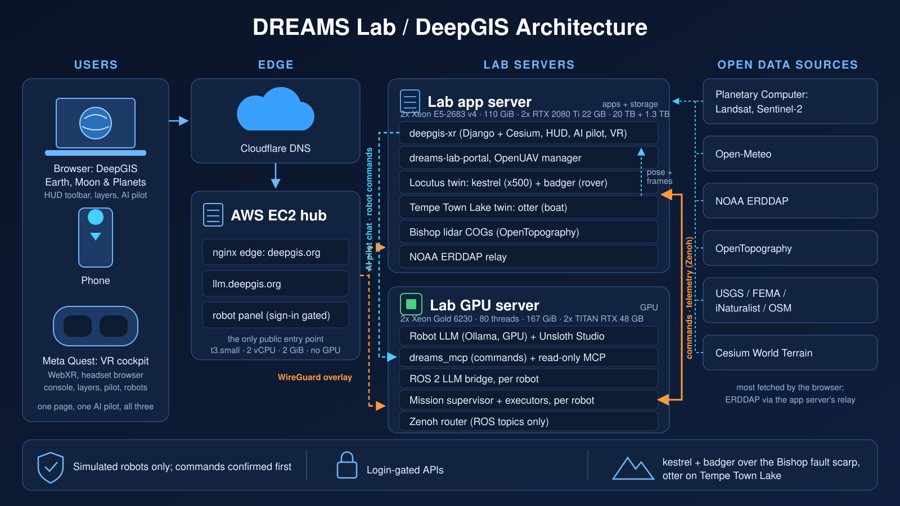

| Host | Hardware |
|---|---|
| Public edge (AWS EC2 `t3.small`) | Intel Xeon Platinum 8259CL 2.5 GHz, 2 vCPU (1 core, 2 threads), 2 GiB, no GPU |
| Lab app server | 2x Intel Xeon E5-2683 v4 (2.1 GHz base, 3.0 GHz turbo), 32 cores / 64 threads, 110 GiB, 2x NVIDIA GeForce RTX 2080 Ti (11 GB each), 20 TB + 1.3 TB storage |
| Lab GPU server | 2x Intel Xeon Gold 6230 (2.1 GHz base, 3.9 GHz turbo), 40 cores / 80 threads, 167 GiB, 2x NVIDIA TITAN RTX (24 GB each) |

The edge routes `/label/` and `/api/v1/` to deepgis-xr and everything else to the lab
portal; the LLM studio host and the sign-in-gated robot panel also pass through it. The
app server runs deepgis-xr, the portal, the PX4 + Gazebo twins (kestrel and badger in the
Bishop world, otter on Tempe Town Lake), the stored lidar and the ERDDAP relay. The GPU
server runs the robot language model, the MCP servers, and a ROS 2 LLM bridge and mission
supervisor per robot; robot topics cross to it over Zenoh. Browser, phone and a Meta Quest
in VR all load the same page and the same AI pilot.

The language model only proposes; the mission supervisor checks every command
against its limits (geofence, altitude band, battery, telemetry age), and each
vehicle's executor is the only writer of PX4 setpoints. deepgis-xr talks to the
read-only MCP server for the AI pilot and to the command-enabled one only for
superusers' confirmed robot commands.

### VR pipeline

In a headset, `hud/xr.js` takes over the frame loop from Cesium: each
`XRSession.requestAnimationFrame` tick reads the controllers, advances the
rig (flushing the page's captured `requestAnimationFrame` callbacks so drone
flights keep running, then stepping any robot follow), applies thumbstick
flight and the comfort vignette, aims the laser at the cockpit or the globe,
and finally renders the Cesium scene once per eye with a symmetric frustum
and crops each eye into the WebXR projection layer. `hud/xr-cockpit.js` draws
the console, compass, layers wing, robots and comms panels, wrist menu and
vignette on 2D canvases and uploads them into their own compositor layers,
so text stays sharp at any globe resolution. The robot follow path feeds the
same loop: publishers post poses to `/label/api/vehicles/pose/`, the page
polls `/label/api/vehicles/live/`, eases toward each pose, and in XR the rig
adopts the resulting camera move so the headset rides along.

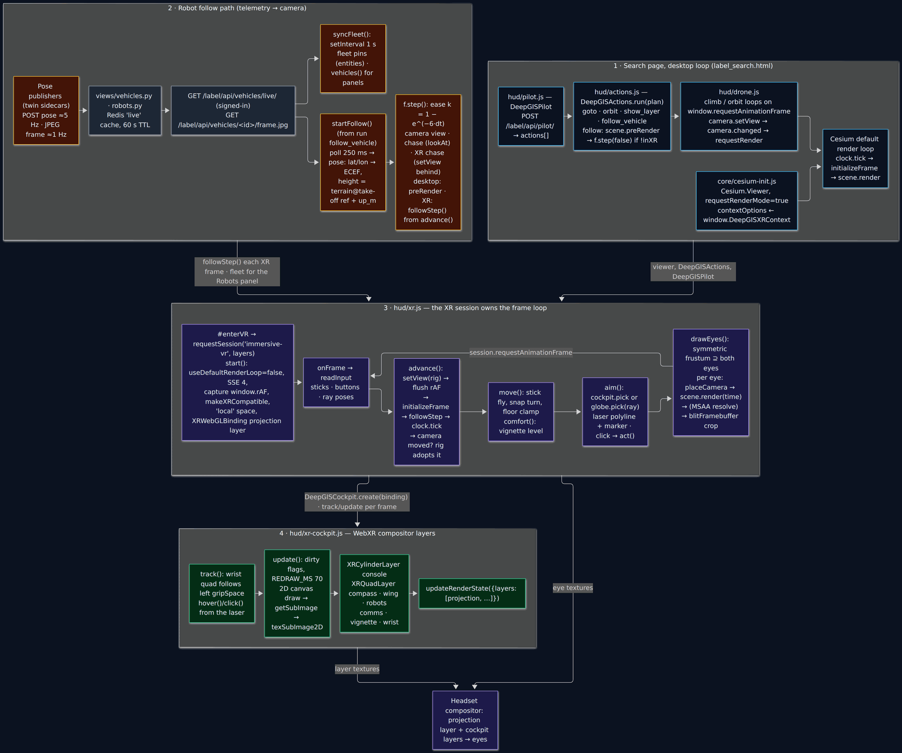

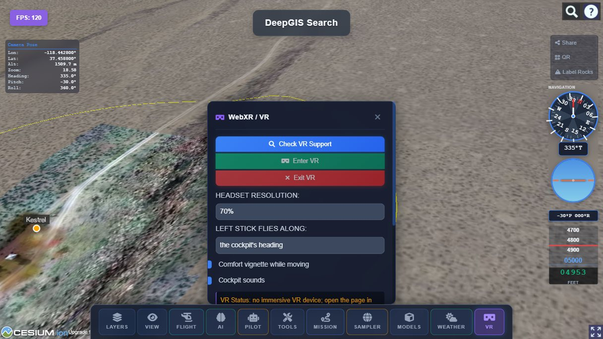

*The Cesium search page on deepgis.org in 3D over the Bishop scarp twin
site: the 2019 drone orthophoto from the tile catalog (`site_imagery`), the
kestrel twin's marker and the WebXR/VR panel open.*

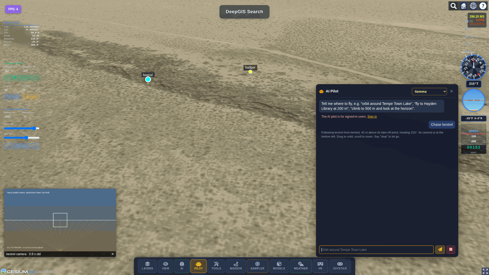

*Desktop `follow_vehicle` chase view of a stubbed `kestrel` pose: fleet pins
(kestrel highlighted, badger), PiP camera frame (placeholder JPEG), pilot
log line.*

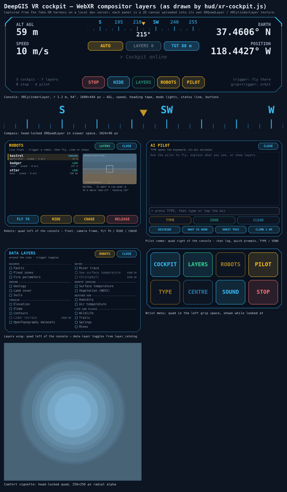

*Montage of the seven cockpit layer canvases exactly as `xr-cockpit.js` drew
them in a fake-XR session: console, compass, robots, comms, layers wing,
wrist menu, vignette.*

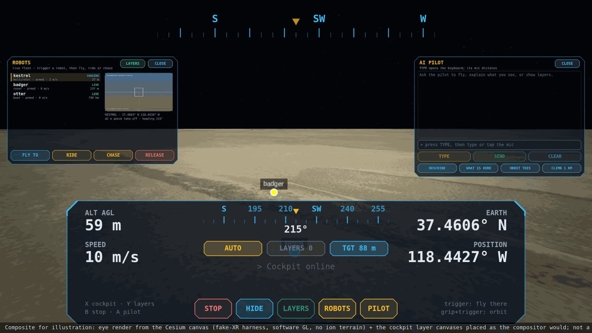

*Illustrative composite: the eye render read back from the Cesium canvas
during the fake-XR session plus the live layer canvases placed roughly
where the compositor puts them. Not a headset capture.*

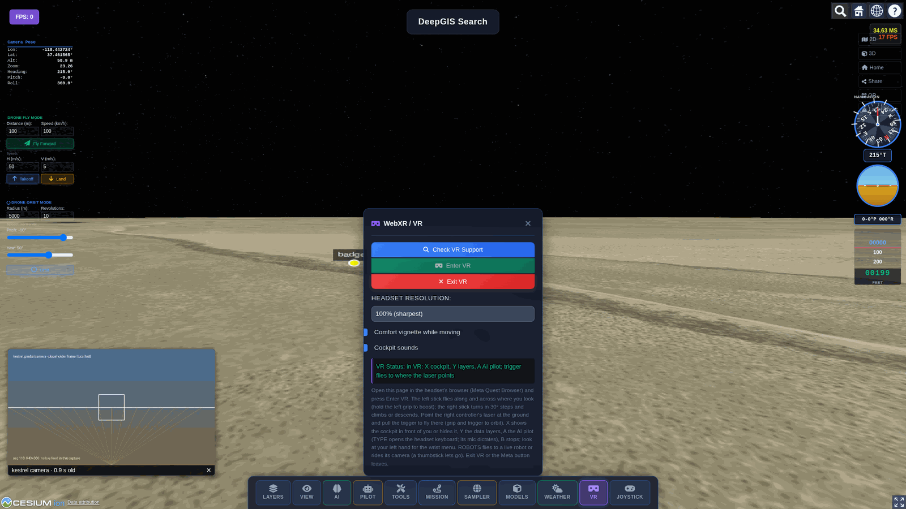

*The page itself while the fake session runs: the canvas holds the wide
symmetric-frustum render (1178×1024 stretched to the viewport), status
"in VR", PiP still updating.*

The headset composite is illustrative, not a real headset capture, and the
fleet shown in every screenshot is a stub (kestrel, badger and otter poses
posted by a local script, with placeholder camera frames). The captures ran
without a Cesium ion token, so terrain is the ellipsoid. The stage-by-stage
trace, the issues found and a suggested order of work are in
[docs/vr-pipeline-analysis.md](docs/vr-pipeline-analysis.md).

### Technology Stack

**Backend**
- Django 5.2 LTS (supported through April 2028) on Python 3.10
- Django REST Framework 3.16
- gunicorn 23 in the web container (workers=2, threads=4, timeout=600; all
  `GUNICORN_*` overridable). `runserver` is for local development only.
- SQLite by default; PostgreSQL 16 opt-in via `DATABASE_URL`
  (`dj-database-url`, `psycopg2-binary`)
- Celery 5.6 + Redis 7 for the admin-only model-training queue (not used for
  per-viewport requests)
- Shapely 2.0, GDAL/rasterio/fiona for GIS processing
- Twilio + `django-phonenumber-field` (phone-number authentication; without
  a Twilio client, phone sign-in is refused unless `DEBUG=True`)
- GDAL (in the image) for the stored lidar endpoint: hillshade and slope
- Flask 3.x topology-tile server in `services/topology/`

**Frontend**
- CesiumJS 1.111, hand-written ES modules in `staticfiles/web/js/` (no build step)
- Bootstrap UI, HUD toolbar with floating panels, shared by every globe:
  template partials in `templates/web/hud/` and scripts in
  `staticfiles/web/js/hud/` (panels, shortcuts, drone, actions, pilot, models, share)
- Geocoding: OpenStreetMap Nominatim, falling back to Cesium Ion

**AI / ML** (the web image ships no model weights; they are fetched on first use)
- Segment Anything (Meta AI), remote API, `SAM_API_URL`; falls back to
  `segment_anything` in the web process, on its GPU, when the API is unreachable
- YOLO26, YOLOE-26 and SAM 3 (Ultralytics 8.4), remote API in
  `services/ultralytics-api/`, `ULTRALYTICS_API_URL`
- Grounding DINO (IDEA Research), remote API, `GROUNDING_DINO_API_URL`
- Mask R-CNN rocks, remote API, `MASKRCNN_ROCKS_API_URL`
- AI pilot: a language model reached through a read-only MCP server
  (`dreams_mcp_ro` from the DREAMS Lab `dreams_llm_ros2` stack),
  `DEEPGIS_PILOT_MCP_URL`; its `ask_robot_llm` tool plans and its
  `describe_image` tool (a vision-capable model) answers `describe_view`.
  Superusers' confirmed robot commands go to the command-enabled `dreams_mcp`
  instead (`DEEPGIS_PILOT_CONTROL_MCP_URL`, with its own token)
- PyTorch 2.5.1 + CUDA 12.1 stays in the image only for the admin training task

**Infrastructure**
- Docker image based on `nvidia/cuda:12.1.0-cudnn8-runtime-ubuntu22.04`;
  `.dockerignore` keeps weights, databases and data out of the build context
- TileServer GL (MBTiles → raster/vector tiles)
- Nginx reverse proxy (optional)

### Project Structure

```
deepgis-xr/
├── deepgis_xr/                       # Django project
│   ├── apps/
│   │   ├── api/v1/                   # DRF v1 (serializers, urls)
│   │   ├── auth/                     # phone-based auth (Twilio)
│   │   ├── core/                     # core models, admin, image processing
│   │   ├── ml/                       # ML helpers (admin training)
│   │   ├── scene_store/              # world model: PostGIS factor graph,
│   │   │                             # fusion, inference, world API, zone maps
│   │   ├── tile_catalog/             # Site→Dataset→Timestep→Product registry
│   │   │   └── management/commands/  # seed_tile_catalog, validate_tile_catalog
│   │   └── web/                      # main web app
│   │       ├── views/                # pages, missions, auth_ajax, ai_reports,
│   │       │                         # training_datasets, semi_supervised,
│   │       │                         # models_3d, pilot (AI pilot + relays),
│   │       │                         # twin_access, vehicles (live poses), robots
│   │       │                         # (registry, aliases, nearby), legacy
│   │       ├── world_sampler.py      # adaptive spatial sampler
│   │       ├── world_sampler_api/    # sampling + AI viewport API
│   │       │   ├── core.py, http.py  # helpers + HTTP endpoints
│   │       │   ├── scenegraph.py     # SceneGraph build (+ urban_taxonomy.py)
│   │       │   └── analyzers/        # per-model analyzers (sam, yolov8,
│   │       │                         # grounding_dino, maskrcnn_rocks, ...)
│   │       ├── templatetags/hud_tags.py  # Layers panel catalog (#hudLayerCatalog)
│   │       ├── tests/                # test_pilot, test_planet, test_twin_access,
│   │       │                         # test_vehicles, test_layers_panel
│   │       ├── templates/web/
│   │       │   ├── label_search.html         # Earth viewer
│   │       │   ├── label_moon_viewer.html    # Moon and planet viewer
│   │       │   └── hud/                      # shared HUD partials
│   │       ├── urls.py, admin.py, models.py, middleware/
│   │       └── management/commands/
│   └── settings.py
├── services/topology/                # standalone Flask tile/3D-tiles server
├── services/ultralytics-api/         # YOLO26, YOLOE-26, SAM 3 (Flask, GPU)
├── staticfiles/web/                  # tracked JS, CSS, vendor libs
│   ├── js/hud/                       # shared HUD, drone, actions (actions.js: LAYERS),
│   │                                 # Layers panel (layers-panel.js), AI pilot, VR (xr.js)
│   ├── js/planet-bodies.js           # body registry: radii, imagery, terrain
│   └── geo/                          # tempe-geology.geojson, nomenclature/<body>.json
├── scripts/                          # sync_assets.sh, GLB optimizer, API clients,
│                                     # build_planet_nomenclature.py, topo_pull.py
├── tests/js/                         # node:test cases for the planet registry
├── examples/                         # kernelcal demos
├── GroundingDINO/                    # vendored upstream repo
├── static/, media/, data/, deepgis_results/   # runtime assets (gitignored;
│                                     # stored lidar COGs live in data/topo/)
├── Dockerfile                        # web image (Ubuntu 22.04, CUDA 12.1, Python 3.10)
├── docker-compose.yml                # web, redis, celery_worker, tileserver (+ db profile)
├── requirements.txt                  # pinned runtime deps
└── requirements-dev.txt              # pytest, ruff, black, pip-tools
```

---

## 🔌 API Endpoints

### AI Pilot

- `POST /label/api/pilot/`: one chat turn. Requires a signed-in session and
  the CSRF token. Rate-limited per user (`DEEPGIS_PILOT_RATE_PER_MIN`,
  default 12).
  - **Body:** `{"message": "...", "body": "earth", "view": {lat, lon,
    height_agl, heading_deg, target: {lat, lon}}, "history": [{role, content}, ...]}`.
    `body` is `earth` (default), `moon`, or any id in `planet-bodies.js`;
    it selects the prompt, the layer kinds offered and the limits.
  - **Returns:** `{"reply": "...", "actions": [...], "model": "...",
    "duration_sec": ...}`. Unknown action types, kinds and fields are
    dropped, numbers are clamped (on Earth: heights 5 m to 20 km, orbit
    radius 20 m to 20 km, layer radius up to 200 km, speed 1 to 300 m/s; off
    Earth: heights up to 500 km, speed up to 6 km/s), and at most 8 actions
    are returned. Actions come back in schema key order, and assistant turns
    in `history` are re-cleaned on the server.
  - **Errors:** 401 `login_required` (with `login_url`), 400 for an empty or
    invalid message, 429 when rate-limited, 503 if the pilot is not
    configured, and 502 if the model is unavailable.
  - For superusers, when robot commands are configured, the schema also
    offers `robot_command {vehicle, command, instruction?}`. It is kept only
    for robots the command server lists as taking commands.
- `POST /label/api/pilot/robot-command/`: sends one confirmed
  `robot_command`. Superusers only (403 otherwise), CSRF, 6 commands/min per
  user.
  - **Body:** `{"vehicle": "kestrel", "command": "instruct" | "return_home" |
    "land", "instruction": "...", "dry_run": false}`. `instruction` is
    required for `instruct`. `dry_run` (instruct only) plans without moving
    anything.
  - **Returns:** the cleaned command plus the supervisor's `accepted`,
    `result` (`dry_run`, `in_progress`, `rejected`, `needs_clarification`,
    and so on), `message`, and for instructions the `plan` (steps,
    waypoints, path length, how it ends). Every command is appended to
    `var/ops/robot-commands.jsonl` with the user's name.
  - **Errors:** 401, 403, 400 for an unknown robot or command, 429, 503 if
    not configured, and 502 if the command server fails. On a timeout the
    command may still have reached the robot, and the message says so.
- `POST /label/api/pilot/describe/`: the `describe_view` action. Same
  sign-in and CSRF rules; 6 requests/min per user.
  - **Body:** `{"image": "data:image/jpeg;base64,...", "body": "mars",
    "view": {..., pitch_deg}, "question": "..."}`. The image is one JPEG or
    PNG frame of the canvas (the page sends a JPEG at most 1280 px wide),
    up to 3 MB encoded.
  - **Returns:** `{"summary": "...", "observations": ["...", ...], "model":
    "...", "duration_sec": ...}`, at most 12 observations. Expect 15 to 25 s.
  - **Errors:** 401, 400 for a missing or non-image `image`, 429, 503, and
    502 as above.
- `GET /label/api/pilot/ocean/?kind=&south=&north=&west=&east=`: relay for
  the `sea_temp` and `chlorophyll` layers, because NOAA ERDDAP sends no CORS
  headers. Signed-in users only; two allow-listed datasets, so it is not an
  open proxy. Boxes are limited to 10° a side and grids to 160 cells a side;
  results are cached for 3 hours, 20 requests/min per user. Returns
  `{time, lat, lon, values, res, dataset}`.
- `GET /label/api/pilot/topo/?lat=&lon=&radius_m=`: the `lidar_dem` layer
  from the OpenTopography surveys stored in `data/topo/`. Signed-in users
  only. Picks the survey that best covers the circle (moving a request just
  off a survey onto its nearest well-covered ground, up to 30 km), and
  returns one PNG packing height, hillshade, slope and coverage, plus relief
  and slope figures. `?list=1` lists the stored surveys and their bounds.
  20 requests/min per user, cached for 24 hours.

### Live vehicles

- `POST /label/api/vehicles/pose/`: a vehicle's latest pose. Needs
  `Authorization: Bearer <token>` with a token listed (as its SHA-256) in
  `VEHICLE_POSE_TOKENS`, or, for a `vehicle` starting with
  `VEHICLE_FLEET_PREFIX` (default `openuav-`), the hex
  HMAC-SHA256(`VEHICLE_FLEET_SECRET`, vehicle id); no session or CSRF.
  - **Body** (JSON, at most 4 KB): `{"vehicle", "name", "kind": "sim" |
    "field", "lat", "lon", "up_m", "alt_amsl", "ref": {lat, lon, alt_amsl},
    "heading_deg", "gimbal_pitch_deg", "hfov_deg", "speed_mps", "armed",
    "landed"}`. Only `lat` and `lon` are required; `up_m` is the height
    above `ref`, the take-off point. Out-of-range numbers are dropped, not
    clamped.
  - **Returns:** `{"ok": true}`. The pose is kept for 60 s in the shared
    `live` cache.
  - **Errors:** 503 if neither tokens nor a fleet secret are configured,
    401 for a missing or unknown token, 403 if `vehicle` is not the token's
    vehicle, 413, and 400 for invalid JSON or a missing position.
- `GET /label/api/vehicles/live/`: signed-in users only (401 otherwise).
  Returns `{"vehicles": [{id, name, kind, lat, lon, ..., age_sec}, ...]}`,
  freshest first; vehicles whose pose expired drop off the list. The page
  polls it four times a second while following.
- `POST /label/api/vehicles/frame/`: a vehicle's latest camera frame, with
  the same token as its poses.
  - **Body:** one JPEG (`Content-Type: image/jpeg`, at most 600 KB and
    4096 px a side). The optional `X-Frame-Meta` header is a JSON object:
    `vehicle`, `captured` (Unix seconds) and any of the pose fields above,
    as they were at capture.
  - **Returns:** `{"ok": true, "seq": n}`. The frame is kept for 60 s.
  - **Errors:** as for poses, plus 400 when the body is not a JPEG or the
    header is not a JSON object.
- `GET /label/api/vehicles/<id>/frame.jpg`: that frame, for signed-in users
  only (401 otherwise); 404 when there is none. `vehicles/live/` adds
  `frame: {seq, w, h, age_sec}` to each vehicle that has one.
- `GET /label/api/vehicles/nearby/`: robots near a point or another robot,
  for signed-in users or a bearer token from `ROBOT_READ_TOKENS`.
  - **Query:** `lat` and `lon`, or `near=<callsign or alias>`; `radius_m`
    (0 = any distance); `platform` (`multirotor`, `rover`, `boat`, `drones`...);
    `q` (a callsign, alias, world or platform word); `offline=1` to include
    robots with only a last-known position; `limit`.
  - **Returns:** `{"robots": [{id, name, platform, airframe, site, online,
    lat, lon, distance_m, bearing_deg, direction, ...}, ...]}`, live first,
    then nearest.

### Viewers and access

- `GET /label/3d/search/`: Earth viewer. `GET /label/3d/moon/`: Moon viewer.
  `GET /label/3d/planet/<body>/`: any body in `planet-bodies.js`.
- `GET /label/api/twin-access/`: 204 for a signed-in member of the
  `twin-pilots` group, 401 when signed out, 403 otherwise. Meant for a
  reverse proxy's `auth_request`, so an external digital-twin panel can
  reuse the DeepGIS sign-in.

### AI Analysis API

- `POST /webclient/sampler/analyze-viewport`: analyze the current viewport
  - `model_type`: `'sam'` (default), `'yolov8'`, `'grounding_dino'` or
    `'maskrcnn_rocks'`; anything else returns 400
  - `image`: Base64-encoded viewport image; `location`: camera metadata
  - **SAM:** `sam_model` (`'vit_b'`, `'vit_l'`, `'vit_h'`), `min_area` (pixels)
  - **YOLO (`model_type: 'yolov8'`, kept for compatibility):** `yolo_model`
    (`'yolo26n-seg'` to `'yolo26x-seg'`, `'yoloe-26s-seg'` to `'yoloe-26l-seg'`,
    or `'sam3'`; old `'yolov8n'`..`'yolov8x'` map to YOLO26),
    `confidence_threshold`, `class_filter` (comma-separated; COCO names for
    YOLO26, any phrases for YOLOE-26 and SAM 3, which require it)
  - **Grounding DINO:** `text_prompt` (dot-separated, e.g.
    `"rock . boulder . crater"`), `box_threshold` (default 0.3),
    `text_threshold` (default 0.25)
  - **Mask R-CNN rocks:** `model_id` (blank for the service default),
    `score_threshold` (default 0.5), `max_detections` (default 200)
  - **Returns:** a GeoJSON FeatureCollection with detections and metadata
  - **Graceful degradation.** If a remote service is unconfigured,
    unreachable or times out, the endpoint returns **HTTP 200** with an empty
    FeatureCollection and `degraded: true`. It also sets `unavailable_reason`
    (`"not_configured"`, `"connection_error"`, `"timeout"`, or
    `"weights_missing"` for SAM 3 without its weights) and a
    `Retry-After` header (30 s; 60 s on timeout). The frontend's
    per-viewport poll therefore stays quiet during outages. Real upstream 5xx
    responses and analyzer crashes still surface as 502/500.

### World Sampler API

- `POST /webclient/sampler/initialize`: initialize a sampler
- `POST /webclient/sampler/sample`: get sample locations
- `POST /webclient/sampler/update`: update the distribution
- `GET /webclient/sampler/query`: query a spatial region
- `GET /webclient/sampler/statistics`: distribution statistics
- `POST /webclient/sampler/reset`: reset the sampler
- `GET /webclient/sampler/history`: sample history

### SceneGraph and world model API

- `POST /webclient/sampler/scenegraph/build`: fuse per-kernel results into a
  SceneGraph. Optional `taxonomy` (`phx_urban_v0` or `urban_v1`; defaults to
  `urban_v1` when SAM 3 or YOLO contributed). The response includes
  `world_update` (matched, new and missed entities) when the world model is on.
- `GET /webclient/sampler/world/entities?bbox=west,south,east,north`: world
  entities in a box (at most 0.05° square). Optional `at` (ISO 8601 with a
  zone) recomputes beliefs for that instant, `taxonomy`, `min_p_exists`,
  `min_score` (only entities at least that sure of their category).
- `GET /webclient/sampler/world/entities/<id>`: one entity's belief history,
  detections, feedback, factor counts and `support` (the looks the belief
  rests on).
- `POST /webclient/sampler/world/feedback`: `{entity_id, kind: confirm |
  relabel | reject, category?, note?, imagery?, seen?}`; sign-in required.
  `imagery` is the page's record of the imagery the judgement was made on
  and dates the correction; `seen: "in_person"` dates it now.
- `GET /webclient/sampler/world/review?bbox=...[&limit=]`: entities nobody
  has judged yet, most uncertain first, each with `value_bits`.
- `GET /webclient/sampler/world/assess?lon=&lat=[&at=][&sigma_m=][&taxonomy=]`:
  the fused assessment at a point: `fused` (category, candidates,
  `no_object`), the `objects` composed with their weight, share and
  support, `looked_at` (captures and distinct images covering the point)
  and the latest remote-sensing values over the main object.
- `GET /webclient/sampler/world/imagery_checks?bbox=...`: `flags`, the
  captures whose basemap imagery has since been replaced by a later
  acquisition; for a signed-in page also `due`, the captures to look up
  again. `POST` with `{checks: [{session_id, imagery}]}` (sign-in required)
  records what the provider serves now.
- `GET`/`POST /webclient/sampler/world/preferences`: per-user settings as a
  JSON object (`null` deletes a key); sign-in required.
- `GET /webclient/sampler/world/stats[?taxonomy=]`: counts, the imagery
  windows of the captures and the fitted detection models, plus per-source
  label agreement with user feedback when a taxonomy is given.
- `GET /webclient/sampler/world/captures?bbox=west,south,east,north`: stored
  captures (scene graphs) whose footprint meets the box (at most 0.5°
  square), newest first, each with its `reward`. Optional `taxonomy`,
  `limit`.
- `GET /webclient/sampler/world/captures/<session_id>`: one capture's
  footprint, its entities with their current beliefs, and the context and
  contains links between them that were valid at capture time. Captures
  carry `gsd_m`, `min_object_m2` (the smallest object a miss counts for),
  their current `pose` (source and uncertainty), `captured_at` (the view),
  `observed_at` (the imagery date, or the view time when it is unknown) and
  `imagery`.
- `GET /webclient/sampler/world/summary?bbox=...`: counts per category,
  confidence bins, and the best guesses behind the *unknown* entities.
- `GET /webclient/sampler/world/changes?bbox=...&since=YYYY[-MM[-DD]][&until=][&basis=imagery|view]`:
  entities first seen in the window, and those missed in it (by captures
  that could resolve them) that are now believed gone. The window is in
  imagery dates unless `basis=view`.
- `GET /webclient/sampler/world/trait_map?bbox=...[&trait=area|confidence|p_exists][&category=]`:
  per-category statistics and histograms of one trait, and a
  Gaussian-process map of one category.
- `POST /webclient/sampler/world/retire` and `.../restore`:
  `{entity_ids: [...] (up to 50), reason?}`; superusers only, CSRF token
  required. Retiring supersedes the entities' factors; restoring revives them.
- `GET|POST /webclient/sampler/world/next_view` with `taxonomy`, `policy`
  (`thompson`, `uniform` or `greedy`), `bbox`, `image_size`, `run`, `seed`,
  all optional: the view a sampling policy would capture next (centre,
  ground sample distance, footprint) and the `bits_new` it expects. `GET`
  only shows it; `POST` stores the proposal and returns its `pull_id`.
- `GET /webclient/sampler/world/pulls[?taxonomy=][&run=]`: stored proposals
  with what each expected and returned, a comparison per policy and the
  fitted yields. `POST {pull_id, session_id}` attaches the capture that
  answered a proposal (it must be newer than the proposal and cover its
  centre); `{pull_id, error}` records that there was none.
- `GET /world-model/zones/<slug>`: the page of a zone's latest fused map;
  `<slug>.pdf`, `.png` and `.jpg` are the map itself (`?download=1` saves it
  under a dated name) and `<slug>.json` its numbers, with `latest` saying
  whether the store has changed since it was drawn. `GET /world-model/`
  lists the zones. Public, read-only.

Without `OBSERVATIONS_DATABASE_URL` the world endpoints return 503 and builds
skip the world model.

### Scene-graph MCP server

`POST /api/v1/mcp` serves the world model to MCP clients (Cursor, Claude,
agents) over streamable HTTP: stateless JSON-RPC, read-only, with a bearer
token whose SHA-256 is listed in `SCENE_MCP_TOKENS` (comma-separated). It is
off until a token is configured. Areas are a point and a radius instead of a
bbox, and objects come back as centre points unless outlines are asked for,
so a city block fits in a model's context.

| Tool | Answers |
|---|---|
| `world_stats` | Totals, categories per taxonomy, the low-confidence threshold, imagery dates, the fitted detection model, the remote-sensing record per source, captures due a re-capture |
| `list_scene_graphs` | Stored captures near a point (or the newest anywhere), with resolution and `reward` (the bits each removed, by cause); `include_footprints` adds each outline |
| `get_scene_graph` | One capture's nodes and their `context` / `contains` links |
| `world_summary` | Counts per category, confidence spread, what the unknowns probably are |
| `find_entities` | Objects near a point: category, top candidates, `p_exists`, area, distance; `at=` for a past time |
| `get_entity` | One object's sightings (imagery date and view time), belief when last seen and today, history, feedback, field readings, `layers` (its Sentinel-2 and NAIP NDVI series and lidar height with their purity) and `support` (the independent looks behind the belief) |
| `assess_point` | What is at one point: the category distribution composed from the objects covering it, the chance that none does, what was looked at there |
| `world_changes` | Objects that appeared, or are believed gone, between two imagery dates (`basis: view` for view times) |
| `area_histogram` | Object sizes in an area |
| `trait_map` | Per-category statistics of area, confidence or `p_exists`, and a Gaussian-process map of one category |
| `field_readings` | The ground survey as counts per day: spectra, ranges, targets, image-note words. No position |
| `entity_looks` | The captures whose footprint covers one object, and whether each found it or counted a miss |
| `belief_history` | An object's stored belief after each capture or correction |
| `entity_beliefs` | Every live object's belief, in pages, so a whole taxonomy can be read |
| `next_view` | The view a sampling policy would capture next and the bits it expects (a preview; nothing is stored) |
| `sampler_pulls` | Stored sampling proposals: predicted against realised bits per capture, compared per policy |

Client configuration (Cursor `~/.cursor/mcp.json`):

```json
{"mcpServers": {"deepgis-scene-graph": {
  "url": "https://deepgis.org/api/v1/mcp",
  "headers": {"Authorization": "Bearer <token>"}}}}
```

Create a token with `openssl rand -hex 24` and add `sha256sum` of it to
`SCENE_MCP_TOKENS` in `.env`.

### Labeling API

- `POST /label/semi-supervised/api/generate-labels/`: generate assisted labels
- `POST /label/semi-supervised/api/save-labels/`: save labels
- `GET /label/semi-supervised/api/get-images/`: get label images

### Tile Catalog API

- `GET /api/v1/tile-catalog/`: the hierarchical layer registry used by the
  Cesium frontend. It returns a versioned JSON tree of
  `Site → Dataset → Timestep → Product` for every active product,
  denormalised so the layer panel needs no further round-trips:

  ```json
  {
    "version": 1,
    "generated_at": "2026-04-27T...",
    "sites": [
      { "slug": "phx_wildfire", "name": "Phoenix wildfire site",
        "bounds": [...], "default_zoom": 18,
        "datasets": [
          { "slug": "wildfire_orthos", "kind": "timeseries",
            "timesteps": [
              { "label": "2020-08", "sort_key": "2020-08-02",
                "products": [
                  { "layer_id": "bf_aug_2020_raster", "kind": "orthophoto",
                    "label": "Orthophoto (Aug 2020)", "default_opacity": 0.7 }
                ]}
            ]}
        ]}
    ]
  }
  ```

  Edit it in the Django admin at `/label/admin/tile_catalog/`. Bootstrap it
  with `python manage.py seed_tile_catalog`, and check for drift against
  tileserver-gl `/data.json` with `python manage.py validate_tile_catalog`.

---

## 🧑‍✈️ AI Pilot Architecture

```
Browser: any viewer (Earth, Moon, planets)  ── Pilot panel
  │  POST /label/api/pilot/  {message, body, current view, recent history}
  ▼
Django: views/pilot.py
  │  signed-in user · CSRF · per-user rate limit
  │  MCP tools/call ask_robot_llm with a JSON schema for {reply, actions}
  ▼
Read-only MCP server (dreams_mcp_ro) ──► language model
  │  returns {reply, actions}
  ▼
Django: keep known action types and fields, clamp every number
  │  {reply, actions, model, duration_sec}
  ▼
Browser: run actions in order on the drone controls
     goto · orbit · takeoff · land · look · stop · wait
     show_layer {kind} · hide_layer {kind?}
       └─ LAYERS[kind].load() fetches from the public source in the browser
          (or through /label/api/pilot/ocean/ and /topo/), then the page
          draws, lists and cites the result
     describe_view
       └─ wait for tiles, capture the canvas as a JPEG,
          POST /label/api/pilot/describe/ ──► MCP describe_image ──► vision model
          returns {summary, observations}, shown in the chat and kept in history
     follow_vehicle {vehicle?, view: camera | chase}   (Earth only)
       └─ poll GET /label/api/vehicles/live/ and ease the camera to each pose;
          poses arrive from publishers via POST /label/api/vehicles/pose/
     robot_command {vehicle, command, instruction?}  (superusers, Earth only)
       └─ not run: shown as a card with Preview plan / Send / Cancel;
          Send ──► POST /label/api/pilot/robot-command/ (superuser · CSRF · rate limit · log)
                ──► command-enabled MCP server (dreams_mcp): instruct |
                    return_home_and_land | land_in_place
                ──► mission supervisor (geofence, altitude band, battery,
                    failsafes) ──► the twin's executor ──► PX4
```

### Robot commands (superusers)

- The model only proposes a command; nothing is sent until the user presses
  **Send** on its card. Non-superusers never see the action: their schema
  and prompt do not offer it, and the server drops it.
- The robots offered are the ones the command server's `list_robots` marks
  as taking commands (cached for 60 s). If the server is unreachable, the
  pilot offers no commands.
- DeepGIS holds its own token for the command server
  (`DEEPGIS_PILOT_CONTROL_MCP_TOKEN`). It is separate from the lab's main
  token, so it can be revoked on its own. Each command carries
  `requested_by: deepgis:<username>`, which the supervisor records in its
  ledger.
- Limits are not enforced here. The robot's mission supervisor checks every
  waypoint against its geofence, altitude band, battery and failsafes, and
  rejects what fails.
- Plain-language instructions are planned by the robot LLM through the
  supervisor's `instruct` tool. Its planner describes a multicopter, so
  instructions suit kestrel; for the rover and the boat, use return home and
  land.

Design rules:

- **The model labels; code decides.** The model names the action and the
  values the user stated. The page picks every default: orbit radius from the
  place's size, height of about half the radius, about 75 s per lap, and the
  camera aimed at the centre.
- **Place lookup order:** curated geology sites, then OpenStreetMap Nominatim
  (good for parks, peaks and landmarks), then Cesium Ion. Off Earth: the
  page's preset sites, then the IAU gazetteer for that body
  (`staticfiles/web/geo/nomenclature/<body>.json`, built by
  `scripts/build_planet_nomenclature.py`). Lookups are cached per page.
- **Layer contents cannot be invented.** For `show_layer {kind, place,
  radius_m}` the model picks only the kind, the centre and the radius; the
  prompt tells it never to describe layer contents in its reply. Django
  accepts only the known kinds (`LAYER_KINDS` on Earth, `PLANET_LAYER_KINDS`
  per body). Each kind in `LAYERS` (in `staticfiles/web/js/hud/actions.js`)
  has a default radius and a `load()` that returns
  features to draw, an optional imagery overlay, the chat lines and the
  source citations. One runner draws, lists, cites and frames them all, so
  adding a kind adds no prompt rules or server checks beyond its name.
- **Layers panel.** The toolbar's Layers button opens the same layers as
  toggles (`hud/layers-panel.js`), grouped by theme, on Earth and on bodies
  with terrain layers (Moon, Mars, Pluto). Each row takes a radius in km and,
  for colour-map kinds on Earth, a colour map; its readings, legend and
  sources appear under the row. Layers load around the point in view, or
  around a place typed at the top (Enter reloads the ticked rows there and
  frames it). Rows tick and untick when the pilot shows or hides a layer.
  The kinds, colour maps and radius range come from `layer_catalog(body)` in
  `views/pilot.py`, so the panel offers exactly what `clean_actions` accepts;
  layers fetched through this server (sea temperature, chlorophyll, stored
  lidar) are locked until you sign in. On Earth the tile catalog follows.
- **Pilot widgets** (`hud/pilot-widgets.js`). The AI panel's "Describe this
  view" runs `describe_view` with an optional question (signed-in users; the
  same `/label/api/pilot/describe/` endpoint and rate limit). The View panel's
  "Fly to place" runs `goto` or `orbit` with the pilot's place lookup, or with
  typed `lat, lon`; an orbit runs through the same `DeepGISDrone.orbitAround`
  as the Flight panel's Orbit button, and Stop halts it.
  - `geology` lists curated sites in the circle, samples the Macrostrat map
    at 15 points (the most detailed map at each), lists up to 8 units with
    the source map citation, and drapes the map at 55% opacity.
  - `river` uses `distance_km` (default 50) instead of a radius: it traces the
    NHDPlus flowline downstream and shows gauges that reported discharge in
    the last 12 hours.
  - `landcover` and `soils` drape the NLCD and SSURGO maps; the feature
    layers draw fault lines, flood zones, fire perimeters, observations, OSM
    trails, springs and mines that open details and links when clicked.
  - The colour-map kinds report statistics, not lists: Planetary Computer
    renders the Landsat and Sentinel-2 tiles, and the gridded kinds
    (humidity, air and sea temperature, chlorophyll) are coloured in the
    browser. A colour map named in the message applies even if the model
    leaves it out.
  - `elevation`, `slope` and `contours` colour the globe's own terrain
    (Cesium World Terrain on Earth, LOLA on the Moon); `lidar_dem` colours the
    server's relief image by height and darkens it by hillshade.

  Layers of different kinds stack; `hide_layer` without a kind removes all.
  An orbit of the same centre without a radius widens to keep the area in
  view, and Django moves a `show_layer` ahead of an orbit so it is drawn
  first. A source that fails reports its error and the plan continues.
- **Plans are cancellable.** A new request or the Stop button interrupts the
  current plan. A `stop` action inside a plan halts motion and
  lets the remaining steps (such as `hide_layer`) run.
- **Read-only by construction.** Django holds only the read-only MCP token,
  and that server has commands disabled. Nothing in this path can command a
  vehicle.

Typical latency is about 3 s with a warm model and about 40 s for the first
request after the model has been idle.

---

## 🧠 AI Viewport Analysis Architecture

```
┌──────────────────────────────────────────────────────────────────────┐
│                         DeepGIS-XR Frontend                          │
│  AI Viewport Analysis panel: text prompt, thresholds, model picker   │
└────────────────────────────┬─────────────────────────────────────────┘
                             │ POST /webclient/sampler/analyze-viewport
                             │ {image, location, model_type, …}
                             ▼
┌──────────────────────────────────────────────────────────────────────┐
│               DeepGIS-XR Django Backend (gunicorn)                   │
│  apps/web/world_sampler_api/http.py::analyze_viewport()              │
│   └─ analyzers/  (model_type not in VIEWPORT_MODEL_TYPES → 400)      │
│        sam · grounding_dino · maskrcnn_rocks → remote services       │
│        yolov8 (YOLO26 · YOLOE-26 · SAM 3)    → remote services       │
│        SAM's local fallback                  → web container GPU     │
│                                                                      │
│   On AI-down (not_configured · connection_error · timeout):          │
│      → HTTP 200 + {status:"success", degraded:true, detections:[]}   │
│        Retry-After: 30s (60s on timeout)                             │
└────────────────────────────┬─────────────────────────────────────────┘
                             ▼
┌──────────────────────────────────────────────────────────────────────┐
│     Remote AI host (Flask + CUDA)                                    │
│       :5000  Grounding DINO      (GROUNDING_DINO_API_URL)            │
│       :5002  Mask R-CNN rocks    (MASKRCNN_ROCKS_API_URL)            │
│       :5010  SAM                 (SAM_API_URL)                       │
│       :5000  YOLO26 · SAM 3      (ULTRALYTICS_API_URL)               │
└──────────────────────────────────────────────────────────────────────┘
```

**Grounding DINO** (port 5000): text-based detection  


```bash
# Grounding DINO: detection only
curl -X POST http://<ai-host>:5000/api/predict \
    -F "file=@image.jpg" -F "text_prompt=rock . boulder . crater"

# Mask R-CNN rocks: list the available checkpoints
curl http://<ai-host>:5002/api/models

# Python client
python scripts/grounding_dino_api_client.py --image viewport.jpg --prompt "rock . boulder"
```

**Example prompts:** Geology `"rock . boulder . crater"` · Urban
`"building . car . tree"` · Wildlife `"animal . bird . nest"`

---

## 🎯 Usage

### AI Pilot
1. Open any viewer (Earth `/label/3d/search/`, Moon `/label/3d/moon/`, or
   `/label/3d/planet/<body>/`) and sign in (`/label/admin/login/`).
2. Click **Pilot** in the HUD toolbar and type a request. The page switches
   to 3D, runs the plan and logs each step in the panel.
3. For a data layer, ask for the kind and place ("flood risk around Tempe
   Town Lake") or say "here" for the point in view. Add a colour map by name
   for colour layers ("in viridis"). Click a drawn feature for details and
   source links. "Hide the faults" removes one layer; "clear all layers"
   removes them all. OpenStreetMap layers can take up to a minute.
4. Ask what is in view ("do a visual analysis of the viewport camera scene
   and list what you observe", or "fly to Olympus Mons and describe what you
   see"). The pilot captures the current frame and lists what the vision
   model sees. Treat the list as a model's reading of the picture, not a
   measurement.
5. On Earth, follow a live vehicle ("sync the view with the OpenUAV sim
   camera", "chase kestrel", "follow the rover", "chase alice's OpenUAV sim").
   Without a name the pilot picks the vehicle that reported most recently
   and lists the others; a name that is not live lists the live ones. If
   its poses stop for 3 s the view holds and the panel says so.
6. Press **Stop** at any time. Stop moves only the camera. It does not stop a
   robot; to stop one, ask the pilot to send it home or land it.
7. Superusers: ask a robot to do something ("kestrel, take off and fly 20 m
   north at 15 m", "send kestrel home"). Check the card, optionally press
   **Preview plan**, then press **Send**. The chat shows whether the robot's
   supervisor accepted the command. Ask the pilot to chase the robot to
   watch it.

### AI Viewport Analysis
1. Open DeepGIS Search and the **AI** panel.
2. Choose **SAM**, **YOLO26 / YOLOE-26 / SAM 3**, **Grounding DINO** or (on
   Earth) **MaskRCNN Rocks**.
3. Set the model size and minimum area (SAM); the model, confidence and
   classes (YOLO: pick **SAM 3** and type e.g. `building, tree, car` for
   text-prompted masks); the text prompt and thresholds (Grounding DINO); or
   the checkpoint, score threshold and detection limit (Mask R-CNN rocks).
4. Click **Analyze Viewport**. Results are drawn as labelled polygons.

### World Sampler
Initialize a sampler, draw samples, step through them in survey mode, update
the distribution from feedback, and query regions.

### Moon and Planet Viewers
Open `/label/3d/moon/` for LROC imagery, LOLA terrain and the Apollo sites, or
`/label/3d/planet/<body>/` (`mars`, `mercury`, `venus`, `io`, `europa`,
`ganymede`, `callisto`, `titan`, `pluto`, `charon`). The HUD, Flight panel,
keyboard shortcuts and AI pilot work as on Earth; ask the pilot to fly to an
IAU-named feature ("fly to Olympus Mons").

### 3D Buildings
In DeepGIS Search, check **3D Buildings (OSM)** in the **View** panel or press
`B`. This works best in 3D view (`V`).

### Immersive VR (Meta Quest)
Open the viewer in the headset's browser (Meta Quest Browser), click **VR** in
the HUD toolbar, then **Enter VR**. You stand where the camera was, at true
scale, facing the camera's heading. The left thumbstick flies along and
across where you look (hold the left grip to boost); the right one turns in
30° steps (left, right) and climbs or descends (up, down). Speed grows with
height above the ground. **Headset resolution** trades sharpness for frame
rate (70% by default). Leave with **Exit VR** or the Meta button; the globe
view continues from where you were.

A cockpit console curves around you below eye level, with a compass strip
above the view: height above ground, speed, heading tape, position, and
lights for autopilot, shown data layers and the laser target's distance,
plus the pilot's last status message. To its left, the **layers wing** lists
the data layers in the same groups as the Layers panel. Pointing at a row and
pulling the trigger shows that layer around the point in view, or hides it.
Layers that are fetched through the server are marked SIGN IN until you sign in
on the page. To the right, the **AI pilot comms** panel is the pilot chat,
shared with the chat on the page. Quick prompts (describe the view, what is
here, orbit this, climb 1 km) ask at a touch. TYPE opens the headset's system
keyboard (its mic button dictates), and Enter or SEND asks. Questions about
"the view" refer to where you are looking. A robot command the pilot proposes
is announced but has to be sent from its card in the page chat. Look at your
left controller for the **wrist menu**: COCKPIT, LAYERS, ROBOTS, PILOT, TYPE,
CENTRE (brings the panels in front of you), SOUND and STOP.

On Earth, ROBOTS (on the console, the wrist or the wing's tab) swaps the wing
for the **Robots panel**: the live fleet with status, speed and distance, and
the selected robot's latest camera frame. FLY TO flies to it, RIDE looks through
its camera, CHASE follows from behind and above, and RELEASE (or any thumbstick)
lets go. While riding, head tracking still works, so you can look around from
the robot. A **comfort vignette** darkens the edge of view as the ground streams
past faster or the view turns, and short synthesized tones mark hovers, presses,
fly-tos and the pilot's replies. Both can be switched off in the VR panel.

| Control | Action |
|---|---|
| Right trigger at the ground | Fly there at the current height |
| Right grip + trigger at the ground | Orbit that point |
| Trigger at a panel button or layer row | Press it |
| B | Stop the flight or orbit |
| X | Show the cockpit in front of you, or hide it |
| Y | Show or hide the layers wing |
| A | Show or hide the AI pilot comms |
| Any thumbstick | Takes over from the autopilot |

How it works (`staticfiles/web/js/hud/xr.js`): Cesium 1.111 has no WebXR
support, so each XR frame renders the scene once per eye with the camera at
that eye's pose, then copies the picture into the headset's framebuffer.
Cesium keeps only symmetric frusta correct across its multi-frustum passes,
so each eye is drawn with a symmetric frustum wide enough for both eyes and
its own part is cropped out with `blitFramebuffer`. In headset browsers the
canvas is created XR-compatible and single-sample (`window.DeepGISXRContext`,
read by `core/cesium-init.js` and the planet viewer), so the copy needs no
multisample resolve; FXAA smooths edges instead. Desktop browsers take the
resolve path. During a session the default render loop, mouse controls and
request-render mode are off, and terrain detail is relaxed
(`maximumScreenSpaceError` 4); all of it is restored on exit.

Where the browser supports WebXR Layers (Quest Browser does), the globe goes
into a projection layer and the cockpit (`hud/xr-cockpit.js`) into its own
compositor layers: the console is a cylinder layer, the compass a quad
locked to the head, the layers wing and pilot comms quads on either side of the console and the
wrist menu a quad in the left controller's grip space, all drawn on 2D canvases and redrawn only when a
reading changes. The compositor samples them at full lens resolution,
so text stays sharp whatever the globe's resolution. The console stays
where it was placed (in front of the craft) and turns only with snap turns
or X. Without Layers support the globe falls back to a plain `XRWebGLLayer`
and the cockpit is off. The laser is a Cesium polyline in the scene. It picks
console buttons by intersecting the ray with the cylinder, and the ground
with `globe.pick`. Pilot actions (fly-to, orbit, drone animations) keep
running in VR because the page's `requestAnimationFrame` callbacks are run
from the XR frame loop, and the rig adopts whatever the camera does. Following a
robot is stepped from the same loop (`DeepGISActions.followStep`), and the camera
keeps the headset's own field of view instead of the robot camera's.

### Weather Stations
Click **Weather** in the HUD toolbar, enable stations, and load all states or
CA, AZ, CO or NV individually. Click a station for details.

### Experience URL Sharing
Press `S` (or **Share**) to copy a URL for the current view, or **QR** for a code.

| Parameter | Description |
|-----------|-------------|
| `lon`, `lat`, `alt` | Camera position |
| `heading`, `pitch`, `roll` | Camera orientation |
| `viewMode` | 2D, 3D or Columbus |
| `flyDist`, `hSpeed`, `vSpeed` | Drone fly settings |
| `orbRadius`, `orbPitch`, `orbYaw` | Orbit settings |
| `orbiting`, `flying`, `takeoff`, `landing` | Active mode flags |

### Keyboard Shortcuts

Press `H` in the app for the full list.

| Key | Action |
|-----|--------|
| `B` | Toggle 3D Buildings |
| `V` | Toggle View Mode (2D/3D) |
| `F` | Toggle Full Screen |
| `H` | Show Keyboard Shortcuts Help |
| `S` | Share Current View |
| `Q` | Toggle QR Code |
| `T` | Hide/Show Toolbars |
| `W` | Toggle Wireframe |
| `D` | Drone Fly Forward |
| `U` | Takeoff (Up) |
| `L` | Land |
| `O` | Start Orbit |
| `Space` | Pause/Resume Orbit (ignored while typing) |
| `G` | Flight Panel (speed, fly, takeoff/land, orbit, camera) |
| `J` | Toggle Virtual Joysticks |
| `↑` `↓` `←` `→` | Camera Perspectives (N/S/W/E) |
| `ESC` | Stop Orbit or Climb / Close Panels |

---

## 🔧 Configuration

### Environment Variables

The authoritative list is [`.env.example`](./.env.example). Copy it to `.env`
and edit it. The important settings are:

```bash
# Core
DEBUG=False
SECRET_KEY=                      # openssl rand -hex 32
ALLOWED_HOSTS=deepgis.org,localhost,127.0.0.1

# gunicorn (defaults match the Dockerfile CMD)
GUNICORN_WORKERS=2
GUNICORN_THREADS=4
GUNICORN_TIMEOUT=600

# Database: unset = SQLite; Postgres after the migration runbook
# DATABASE_URL=postgres://deepgis:deepgis@db:5432/deepgis
# PostGIS database for field readings and the world model (optional)
# OBSERVATIONS_DATABASE_URL=postgres://deepgis:<password>@observations_db:5432/deepgis_observations
REDIS_URL=redis://redis:6379/0

# Remote AI services
SAM_API_URL=http://<ai-host>:5010
GROUNDING_DINO_API_URL=http://<ai-host>:5000
MASKRCNN_ROCKS_API_URL=http://<ai-host>:5002
# YOLO26 / YOLOE-26 / SAM 3: services/ultralytics-api, on the compose network
ULTRALYTICS_API_URL=http://ultralytics-api:5000

# Host GPU index for the web container (SAM's local fallback).
# Use a GPU that is not driving a display or simulator.
DEEPGIS_WEB_GPU=0

# AI pilot (optional; the panel shows "not configured" without a token)
DEEPGIS_PILOT_MCP_URL=http://<mcp-host>:8766/mcp
DEEPGIS_PILOT_MCP_TOKEN=         # the READ-ONLY server's token, never a command-enabled one
# DEEPGIS_PILOT_TIMEOUT_SEC=90
# DEEPGIS_PILOT_RATE_PER_MIN=12
# Robot commands for superusers (optional; without both, the pilot offers none).
# The command-enabled server, with a token of its own (its DREAMS_MCP_EXTRA_TOKENS).
# DEEPGIS_PILOT_CONTROL_MCP_URL=http://<mcp-host>:8765/mcp
# DEEPGIS_PILOT_CONTROL_MCP_TOKEN=

# Live vehicles (optional; the pose endpoint returns 503 without tokens)
# One "vehicle_id:sha256(token)" per vehicle, comma-separated; the token
# itself stays with the vehicle's publisher.
VEHICLE_POSE_TOKENS=
# Sims started by the OpenUAV launcher: the same secret as the launcher's
# DEEPGIS_FLEET_SECRET (openssl rand -hex 32)
VEHICLE_FLEET_SECRET=
# VEHICLE_FLEET_PREFIX=openuav-
# Shared cache for live poses, so every gunicorn worker sees them
LIVE_CACHE_URL=redis://redis:6379/1
```

### Static Files

- Django serves `/label/static/deepgis/` (and `MEDIA_URL`) from `STATIC_ROOT`
  (`./static/`, gitignored) through `django.views.static.serve`, whatever
  `DEBUG` is, so the app runs with `DEBUG=False` without a separate file
  server. Responses carry `Cache-Control: no-cache`, so browsers revalidate
  and unchanged files come back as 304; this keeps stale and fresh ES modules
  from mixing. An Nginx alias or whitenoise in front would be faster.
- The tracked source is `staticfiles/`. After adding or changing a file
  there, copy it into `STATIC_ROOT` with `python manage.py collectstatic`, or
  copy the single file.
- The viewers load `hud/actions.js?v=…`, `hud/layers-panel.js?v=…`,
  `hud/pilot-widgets.js?v=…`, `hud/pilot.js?v=…` and `hud.css?v=…` with version
  tags hard-coded in `label_search.html` and `label_moon_viewer.html`. Bump
  the tag of each file you change.
- `hud/actions.js` holds the pilot's actions and data layers and exposes them
  as `window.DeepGISActions` (`run(actions, sink)`, `stop()`, `layers()`,
  `shown()`, `on('layers', fn)`), so toolbar widgets run the same
  `show_layer`, `goto`, `describe_view` or `follow_vehicle` the model asks for.
  `show_layer` with `frame: false` draws without moving the camera.
  A sink, `{msg(kind, text), legend?(spec), described?(data)}`, receives the
  progress lines; `logSink(element)` writes them as chat-style lines.
  `hud/pilot.js` is only the chat and the robot command cards.
- Avoid directories named `data/` for tracked assets, because `.gitignore`
  excludes them. That is why the geology file lives in `staticfiles/web/geo/`.

### Docker Services

**Default (`docker compose up -d`):**

| Service          | Image                       | Role |
|------------------|-----------------------------|------|
| `web`            | built locally (`Dockerfile`)| Django + DRF behind gunicorn; runs `migrate --noinput` on boot; host port 8060; GPU `DEEPGIS_WEB_GPU` |
| `redis`          | `redis:7-alpine`            | Celery broker + result backend (healthchecked) |
| `celery_worker`  | reuses the `web` image      | Single replica for the admin training task (GPU) |
| `tileserver`     | `maptiler/tileserver-gl`    | Serves MBTiles raster + vector tiles; host port 8091 |

**Optional:** `db` (`postgres:16-alpine`, profile `postgres`). Runbook:
`docs/migration-sqlite-to-postgres.md`.

The `command:` entries for `web` and `celery_worker` are single-line JSON
arrays on purpose. Multi-line YAML scalars silently dropped the gunicorn flags.

---

## 📊 Recent Updates

### November 2026: urban scene graph and world model
- **Urban categories**: SceneGraph builds can query SAM 3 (editable prompts)
  and YOLO, fused under `urban_v1`, which adds house, pool, parking lot and
  solar panel. kernelcal's confusion tables are lifted onto the new
  categories; SAM 3, YOLOE and YOLO26 get their own.
- **World model in PostGIS**: the `scene_store` app keeps captures,
  detections, entities and factors, infers each entity's category and
  existence over time, and takes user feedback. See *World model* above.
- **AI panel**: a world-model layer with click-to-inspect and feedback
  buttons, saved per-user panel settings, scene-graph links and show/hide
  toggles, overlays kept out of captured frames, and the unused model
  branches (zero-shot, Mask2Former, Grounded-SAM, house and sibling Mask
  R-CNN, Prithvi) removed from the viewport analysis code.
- **Pilot and the world model**: `find_objects` (SAM 3 by request, with an
  area histogram and stats in the chat; islands of one mask count as one
  object) and `show_scene_graphs` (stored captures in view, drawn on click),
  backed by the new `world/captures` endpoints. A lone `mr_rocks` "rock"
  claim now means *unknown* rather than *debris* in the urban categories.
- **Geometry in the world model**: capture poses with uncertainty, ground
  sample distance, frame-sized regions gated out, size and shape factors,
  resolution-aware misses, and reversible retirement in place of deletes.
- **Pilot questions for the world model**: `world_uncertain`,
  `world_confidence`, `capture_quality`, `world_changes` and, for
  superusers, `retire_entity` with a confirm card and undo; backed by the
  new `world/summary`, `world/changes`, `world/retire` and `world/restore`
  endpoints. The pilot prompt now carries today's date so "since April"
  resolves.
- **Sharper captures, 2D scene graphs**: 3D draws imagery about two zoom
  levels coarser than 2D, which cost SAM 3 more than half its objects in
  a test. Captures now load 2D-level tiles first, and Build Scene Graph
  captures a top-down 2D view centred on what you are looking at, then
  returns the camera. World-model questions and the layer now work in 2D.
- **Object details on click**: world-model shapes open an info box with
  category and runner-up guesses, chance it is still there, size,
  sightings with their image resolution, evidence counts and feedback.
- **Scene-graph MCP server**: `/api/v1/mcp` lets MCP clients query the world
  model: stored scene graphs and their links, objects near a point, one
  object's evidence, area summaries, changes between dates and object sizes.
- **Trait maps**: the pilot's `trait_map` lists every category's size (or
  confidence, or chance of still being there) around the point in view,
  with the lab model's assessment, and draws a Gaussian-process map of one
  category; also a `world/trait_map` endpoint and an MCP tool.
- **Measured detection model**: the weight of a miss comes from a model
  fitted to the store's own repeat looks (pixel size, zoom ratio, category)
  in place of a fixed 0.8, and detections under 64 pixels are kept out of
  the evidence.
- **Corrections and field evidence**: *Correct*, *Relabel* and *Not there*
  in the info box, a *Review next* queue ordered by what an answer is
  worth, and field readings registered to the entity under the laser as
  weak evidence for or against vegetation.
- **Imagery dates**: captures carry the imagery's source and acquisition
  window; evidence is dated by it, beliefs are kept as last seen, and
  change reports compare imagery dates rather than view times.
- **Remote sensing per object**: Sentinel-2 passes, NAIP photographs and a
  lidar survey are stored as dated scenes and sampled onto every object
  they can resolve, each sample with the share of its signal that is the
  object. A daily `watch_layers` run adds new passes; the series is in the
  info box, the API and the MCP server, and is not yet evidence.
- **Basemap re-check**: pages look up again what imagery the provider
  serves where captures were built, and captures on replaced imagery are
  flagged for re-capture.
- **Looks**: captures of the same imagery are one look and send an object
  one message through a hidden "what this image shows" variable, so
  repeating a capture no longer adds confidence; `rerun_beliefs` applied
  it to the stored beliefs.
- **Point assessment**: `world/assess` and the MCP tool `assess_point`
  compose the objects over a point into one answer with its support.
- **Fused map of a zone**: `/world-model/zones/az/tempe` always shows the
  latest map of the zone's objects with its legends, as a page, a PDF and
  an image; `render_zone_maps` draws it again whenever the store changes.
- **MCP for the read-only gaps**: `field_readings`, `entity_looks`,
  `belief_history` and `entity_beliefs` answer the survey, the misses,
  the belief history and the full object list. `field_readings` returns
  no position.
- **Causes and rewards**: every detection is tagged new ground, newly
  resolvable, re-found or re-look; an object found where an earlier capture
  had looked inherits that capture's miss; each capture stores the bits it
  removed. `backfill_causes` applied it to the stored captures.
- **Sampling loop**: `world/next_view` proposes the next capture by Thompson
  sampling over 100 m cells and zoom bands, `world/pulls` keeps predicted
  against realised, and `samplerLoop.run()` runs it on the search page.

### November 2026: digital twins, sims and field readings
- **Create a digital twin** (superusers): ask the AI pilot to "create a digital
  twin of this place" on Earth or the Moon. After a confirm in the chat, the
  ground under the crosshair (terrain, or LOLA elevation on the Moon) is baked
  into a Gazebo world with one kestrel-class drone, by a twin-builder worker
  (`DEEPGIS_TWIN_BUILDER_URL` / `_TOKEN`; a local stub runs without them).
  The pilot shows the job's progress, and the new drone appears on the globe.
- **Sims panel**: signed-in users get a *Sims* toolbar button that lists the
  lab's OpenUAV simulation desktops (the `Simulation` model, editable in the
  admin) and opens one in a new tab. The owner of a session twin (one made
  with create_twin) can stop, start or purge it from the same list.
- **Field readings**: a field robot's camera keyframe, spectrum and laser
  range are kept in the observations database (`FieldReading`), with the
  laser's target on the ground. `/label/api/field-readings/` serves them as
  GeoJSON for the readings layer, and they are browsable in the admin.
- **Acquisition advice**: the reply to each spectrum a robot posts can carry
  exposure advice (target level, band that must not clip, co-add window) from
  sun geometry and the robot's motion, refined now and then by the lab's vision
  model from the robot's camera frame (`DEEPGIS_ACQUISITION_ADVICE`). The
  pilot's description of a robot's frame now says how the rover set its
  exposure.
- **llm.deepgis.org chat**: a superuser chat on the same read-only model path
  as the pilot (`/label/api/llm-chat/`), so it does not load another model
  copy onto the GPUs.
- **Compose**: the `observations_db` PostGIS service, and `migrate
  --database=observations` on start when `OBSERVATIONS_DATABASE_URL` is set.

### November 2026: pilot widgets and immersive VR
- **One Flight panel** (`2ae3f71`): the Fly and Orbit widgets, the quick
  2D/3D/Home buttons, the perspective widget and the joystick toolbar
  button became a single **Flight** panel (`hud/flight_panel.html`,
  `hud/drone.js`): shared horizontal and vertical speeds, fly forward,
  takeoff and land to a target height while holding the view, orbit around
  the point in the middle of the view (radius auto or set, laps, direction,
  pause/stop, progress), camera pitch and yaw sliders, joystick toggle.
  Joysticks move in the local east-north-up frame and climb along the
  geodetic normal (left and right sticks were swapped before); drone
  actions switch a 2D page to 3D first; the toolbar collapses to icons on
  narrow screens; one FPS pill; Cesium's own scene-mode and home buttons
  are hidden. README screenshots refreshed (`docs/images/hud/`).
- **Immersive VR on the Meta Quest** (`5de41e7`): `hud/xr.js` replaces the
  old WebXR module, which never drew into the headset. Each eye is rendered
  at its own pose and cropped into the XR framebuffer; thumbsticks fly,
  snap-turn and climb. Works on Earth and every planet viewer.
- **VR cockpit** (`hud/xr-cockpit.js`): a sci-fi console and compass in
  WebXR compositor layers, a controller laser to fly to or orbit any point,
  STOP and HIDE buttons, X to toggle the cockpit, B to stop.
- **VR layers wing and wrist menu**: every data layer can be toggled with the
  laser in VR (Y shows the wing); a wrist menu on the left controller.
  Layer groups now come from `layer_catalog` for both the desktop panel and VR.
- **VR AI pilot comms**: the pilot chat in VR, with quick prompts and the Quest
  system keyboard and dictation (A shows it). `hud/pilot.js` now exposes
  `window.DeepGISPilot` (`ask`, `busy`, `recent`, `on`) so other panels can ask
  and mirror the chat.
- **VR robots, sounds and comfort**: a Robots panel to fly to, ride or chase a
  live robot from VR with its camera frame, cockpit sounds (WebAudio), a comfort
  vignette driven by optic flow, and both as options in the VR panel.
- **Pilot widgets** (`41c862a`): "Describe this view" in the AI panel and
  "Fly to place" (goto, orbit, typed `lat, lon`) in the View panel.
- **Layers panel** (`f9a58e4`): the pilot's data layers as toolbar toggles,
  grouped by theme, with radius and colour map per row, kept in step with
  the pilot; also on the Moon, Mars and Pluto. Hidden layers now disappear
  at once instead of on the next camera move.
- **Shared actions module** (`8e224ec`): the pilot's runners and data layers
  moved to `hud/actions.js` (`window.DeepGISActions`), so widgets and the
  pilot run the same actions.

### October 2026: planets, colour maps and terrain
- **Every OpenUAV sim on the globe** (`79de0b7`): sims launched by the
  OpenUAV launcher post their poses with per-sim tokens derived from one
  shared secret (`VEHICLE_FLEET_SECRET`), and the pilot follows any of them
  by name.
- **Follow a live vehicle** (`eef4e13`): the pilot's `follow_vehicle` action locks the
  Earth view to a live vehicle, through its camera or from behind, using
  poses from `POST /label/api/vehicles/pose/` (token per vehicle, read-only).
  The first publisher is the OpenUAV PX4 SITL + Gazebo digital twin.
- **Visual analysis of the view** (`4186fdf`): the pilot's `describe_view`
  action captures the 3D view and asks the lab's vision model, through the
  read-only MCP server's `describe_image` tool, to summarise it and list what
  it sees. Works on Earth, the Moon and every planet viewer.
- **AI panel trimmed** (`4253571`): the AI Viewport Analysis panel offers
  SAM, YOLOv8, Grounding DINO and Mask R-CNN rocks only, and
  `analyze-viewport` rejects other model types. The web container's GPU is
  now set by `DEEPGIS_WEB_GPU`, so SAM's resident fallback model can sit on
  a GPU that isn't rendering.
- **Moon viewer rebuilt** (`c99e2c2`, `66d1fab`): a real Moon-sized globe
  (the old one was Earth-sized with the camera inside it), correctly tiled
  LROC QuickMap imagery, LOLA terrain, and a working fly/orbit drone.
- **Planet viewer** (`6964045`): `/label/3d/planet/<body>/` for ten more
  bodies from one registry (`planet-bodies.js`) with IAU radii, USGS
  Astrogeology and NASA Trek imagery.
- **One HUD everywhere** (`8937bf4`, `a8924e0`, `bcd9962`): Earth's toolbar,
  panels, instruments, shortcuts, camera drone and AI pilot became shared
  partials and modules, so every globe has the same UI. Off Earth the pilot
  uses the IAU gazetteer and orbiter-scale limits.
- **Terrain layers on the Moon, Mars and Pluto** (`6c6b669`).
- **Running with `DEBUG=False`** (`91b40b5`, `6f47702`): static files served
  explicitly with `no-cache`; phone sign-in no longer creates and signs in
  an account for any number when Twilio is not configured.
- **Twin access check** (`1e2f2a5`): `/label/api/twin-access/` for a reverse
  proxy's `auth_request`.
- **Sharper 2D view on HiDPI displays** (`127cd29`) and the Search viewer's
  vestigial sidebar removed (`9024b17`).
- **Colour-map layers** (`6da7dcb`, `63c8820`): Landsat surface temperature,
  Sentinel-2 NDVI, humidity, air temperature, sea surface temperature and
  chlorophyll, with selectable colour maps and the ERDDAP relay. Fixed plans
  coming back empty for follow-up layer requests (key order in history).
- **Terrain and lidar** (`bedde97`): Earth elevation, slope and contours, the
  OpenTopography catalog, and five Bishop-area OpenTopography surveys stored
  on the server (`scripts/topo_pull.py`) behind `/label/api/pilot/topo/`.

### Mid-October 2026: AI pilot and geology
- **AI pilot chat** on the search page (`e93397e`): `POST /label/api/pilot/`,
  a read-only MCP model backend, and validated, clamped actions run in the
  browser. The drone controls were fixed along the way:
  - takeoff and land now take a target height and move along the local
    vertical;
  - the orbit start angle is scaled by cos(latitude), so orbits no longer
    jump when they start;
  - a 0° pitch or yaw is no longer replaced by the defaults;
  - Space no longer pauses an orbit while you type.
- **Sourced geology** (`7ee352e`): `show_geology` / `hide_geology` with a
  curated Phoenix/Tempe GeoJSON. Mapped site names resolve before Ion, which
  has no peaks. A redundant `goto` before an orbit is skipped. A `stop` step
  no longer cancels the rest of the plan.
- **Geology anywhere** (`5678038`): OpenStreetMap Nominatim geocoding first,
  Macrostrat geologic-map units with citations, and a draped map overlay.
- **Data layers**: `show_geology` / `hide_geology` became one
  `show_layer {kind, place, radius_m}` / `hide_layer {kind?}` pair with ten more
  kinds: faults, flood, fires, river (with live USGS flow), landcover, soils,
  wildlife, trails, springs and mines. The action schema now puts `kind`
  before `place`. Under constrained decoding, the model had otherwise
  skipped the place.

### April 2026: Django 5.2 LTS and a slimmer image
- **Django 3.2 → 5.2.13 LTS**, DRF 3.12 → 3.16.1, Shapely 1.8 → 2.0,
  django-cors-headers 4.9, phonenumber-field 8.4. The codebase had been
  cleaned of 4.x/5.x deprecations first. `STORAGES` is declared explicitly,
  and `ModelOptimizationMiddleware` was fixed for Django 5's async-mode check.
- **Docker base** Ubuntu 20.04 → 22.04 with native Python 3.10.
  `.dockerignore` cut the build context from about 15 GB to 2 GB. Model
  weights and the ultralytics and segment-anything packages left the web image.
- **Compose** `command:` blocks switched to JSON arrays. gunicorn had been
  starting with its default bind of `127.0.0.1:8000` and no flags.
- **Tile catalog** (Tier F of the layer UX): hierarchical layer panel, time
  scrubber, swipe and overlay comparison, viewport filter, and an
  "Uncategorized" group for layers not yet curated.
- **Ops hardening**: gunicorn, Redis + Celery worker, Postgres behind a
  profile, and the graceful AI-down contract on `analyze-viewport`.
- **Refactor tiers A–E**:
  - views split into a package;
  - the world sampler split into `core`/`http`/`analyzers`;
  - a frontend feature-layer registry;
  - `staticfiles/` wired into the static finders;
  - Cesium FPS fixes (60 FPS restored on iGPU and Retina displays).

### December 2025
- 3D Buildings layer (OSM), experience URL sharing with QR codes, Grounding
  DINO remote API, NWS weather stations, HUD toolbar and drone fly/orbit
  modes, and 2D/3D/Columbus switching.

---

## 🗺️ Roadmap

### ✅ Completed
- [x] Viewport analysis: SAM, YOLOv8, Grounding DINO, Mask R-CNN rocks
- [x] Remote AI API architecture with graceful degradation
- [x] World Sampler adaptive sampling
- [x] Moon viewer with navigation widgets
- [x] Weather stations; HUD toolbar and panel system
- [x] Experience URL sharing and QR codes; 2D/3D/Columbus switching
- [x] 3D Buildings layer (OpenStreetMap)
- [x] Hierarchical tile catalog with time scrubber and comparison modes
- [x] Layers panel: the AI pilot's data layers as toolbar toggles, kept in
      step with the pilot
- [x] Pilot widgets: "Describe this view" and "Fly to place" (goto, orbit)
- [x] Immersive WebXR on the Meta Quest (per-eye rendering, thumbstick flight)
- [x] Django 5.2 LTS, Python 3.10, Ubuntu 22.04 image
- [x] AI pilot (language-driven camera drone) with sourced data layers
      (geology, faults, flood zones, fires, rivers, land cover, soils,
      wildlife, trails, springs, mines)
- [x] AI pilot colour-map layers (surface temperature, NDVI, humidity, air
      and sea temperature, chlorophyll) and terrain (elevation, slope,
      contours, OpenTopography catalog, stored lidar)
- [x] Moon and planet viewers (ten more bodies) sharing Earth's HUD, drone
      and AI pilot
- [x] AI pilot visual analysis of the view (`describe_view`)
- [x] AI pilot viewport analysis by request (`find_objects`) and stored
      scene graphs (`show_scene_graphs`)
- [x] Follow a live vehicle (`follow_vehicle`), starting with the OpenUAV
      PX4 SITL + Gazebo twin

### 🔧 Next
- [ ] AI pilot: a sign-in path for lab members, persistent rate limiting
      (shared cache), and server-side geocoding with a cache if traffic grows
- [ ] SQLite → Postgres data cutover
- [ ] `kernelcal` integration: MaxCal World Sampler, Model-Kernel Selector,
      terrain diagnostics endpoint
- [ ] Mission export to MAVLink waypoints
- [ ] Field vehicles on the globe (MAVLink/ROS telemetry over Starlink or
      cellular), with tracks and status alongside the live pose
- [ ] Export a DeepGIS area (terrain and imagery) as a Gazebo world, so
      OpenUAV simulations fly over the real ground
- [ ] Mars high-resolution imagery and terrain (HiRISE/CTX) in the planet viewer
- [ ] Data layers for the remaining bodies

### 🔮 Longer term
- [ ] CLIP/VLM semantic search over imagery
- [ ] Autonomous survey planning
- [ ] Digital-twin integration and 3D reconstruction
- [ ] OpenTopography point clouds (LAS/LAZ) and on-demand DEM pulls beyond
      the stored surveys; Google Earth Engine
- [ ] Automated change detection between time periods

---

## 🤝 Contributing

1. Fork the repository
2. Create a feature branch (`git checkout -b feature/amazing-feature`)
3. Commit your changes and push the branch
4. Open a Pull Request

Follow PEP 8, add docstrings, and include tests for new features.

---

## 📝 License

This project is licensed under the MIT License; see [LICENSE](LICENSE).

---

## 🙏 Acknowledgments

DeepGIS‑XR builds on concepts and systems originally developed for the [Oceanographic Decision Support System (ODSS, MBARI)](https://odss.mbari.org/), the [Agricultural Decision Support System (AgDSS, University of Pennsylvania)](https://github.com/Trefo/agdss), the [OpenUAV Project (University of Pennsylvania, Arizona State University)](https://github.com/Open-UAV), and [DeepGIS (Arizona State University)](https://github.com/DREAMS-lab/deepgis). The DeepGIS project acknowledges support from the National Science Foundation, the United States Department of Agriculture, and the National Aeronautics and Space Administration.

### Technology and data
- **CesiumJS**: 3D globe visualization
- **Meta AI**: Segment Anything (SAM, SAM 2)
- **IDEA Research**: Grounding DINO
- **Macrostrat**: geologic map API and tiles (CC BY 4.0)
- **OpenStreetMap contributors**: Nominatim geocoding, buildings, trails,
  springs, mines and coordinates, via Overpass (ODbL)
- **Arizona Geological Survey**: geology of the Tempe area
- **USGS**: Quaternary Fault and Fold Database, NLDI/NHDPlus, NWIS water data
- **FEMA**: National Flood Hazard Layer; **NIFC**: fire perimeter history
- **MRLC**: National Land Cover Database; **USDA NRCS**: SSURGO soils
- **iNaturalist** observers: wildlife observations (each under its own license)
- **NASA/GSFC/ASU**: LROC QuickMap lunar imagery and LOLA terrain;
  **NASA Trek**: Moon and planetary mosaics
- **USGS Astrogeology**: planetary basemaps and the Gazetteer of Planetary
  Nomenclature (IAU)
- **USGS / NASA**: Landsat 8/9 Collection 2 surface temperature;
  **ESA Copernicus**: Sentinel-2; both via **Microsoft Planetary Computer**
- **Open-Meteo**: current weather conditions (CC BY 4.0)
- **NASA JPL** MUR sea surface temperature and **NOAA** chlorophyll-a, via
  **NOAA CoastWatch** ERDDAP
- **OpenTopography**: dataset catalog and lidar/SfM surveys (each cited by
  its DOI in the chat)
- **Cesium**: Cesium World Terrain
- **National Weather Service**: weather station data

---

## 📧 Contact & Support

- **Repository**: [Earth-Innovation-Hub/deepgis-xr](https://github.com/Earth-Innovation-Hub/deepgis-xr)
- **Issues**: [GitHub Issues](https://github.com/Earth-Innovation-Hub/deepgis-xr/issues)

---

## ⚠️ Disclaimer

This software is provided "as is" without warranty. Use at your own risk. Intended for research and educational purposes. AI analysis results and AI-pilot layer listings should be validated independently for critical applications; flood zones in particular are not an official FEMA determination.

---

**Powered by Earth Innovation Hub (Arizona STEAM non-profit corporation)**
