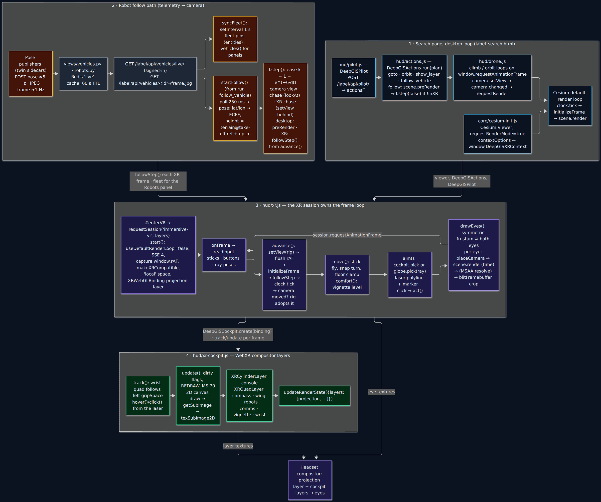
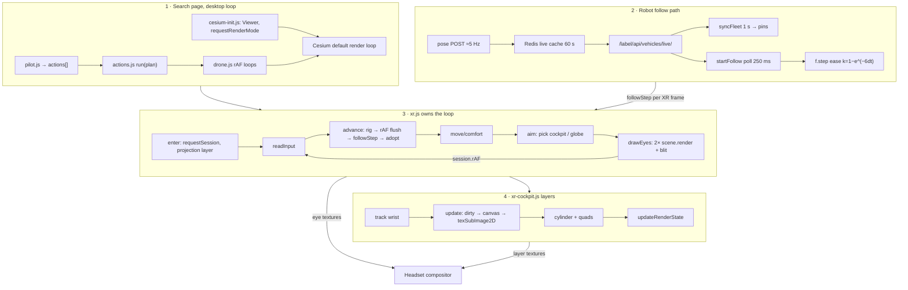

# DeepGIS VR pipeline: layout, issues, suggested order of work

Scope: the immersive WebXR path of the DeepGIS search page in the public repo
`Earth-Innovation-Hub/deepgis-xr` (branch `master`, HEAD `cce60a3`), traced from the code:
`staticfiles/web/js/hud/xr.js` (794 lines), `xr-cockpit.js` (1034), `actions.js` (2526),
`pilot.js` (274), `drone.js`, `core/cesium-init.js`, `main.js`, and the templates
`web/label_search.html`, `web/hud/vr_panel.html`. Line numbers refer to that commit.

Evidence basis: static reading of the code plus a local run of the Django app from the clone
(SQLite, placeholder secrets, no Cesium ion token, Chrome headless with SwiftShader) driving
the real `xr.js` + `xr-cockpit.js` through a fake-XR harness for 53 frames and the desktop
follow path against a stubbed `/label/api/vehicles/live/`. Screenshots are in
`images/vr-pipeline/` (list at the end). Cesium is 1.111 (CDN), which has no WebXR support;
the pipeline below is what the project built around that.

## 1. Pipeline layout today

### Stage 1: page bring-up and the desktop frame loop

| Step | Where | What happens |
|---|---|---|
| Cesium load | `label_search.html:12` | Cesium 1.111 from the public CDN; HUD scripts are classic `<script>` tags in a fixed order (`:61-75`), `xr-cockpit.js` before `xr.js` (asserted by `tests/test_xr.py:8-22`). |
| Viewer | `core/cesium-init.js:80-117` | `requestRenderMode: true`, `preserveDrawingBuffer: true`, `contextOptions.webgl` spreads `window.DeepGISXRContext` (`:110`), which `xr.js:29-30` sets to `{xrCompatible: true, antialias: false}` only for headset user agents. Starts in 2D (`:296`); `debugShowFramesPerSecond` on unless `?fps=0` (`:128-130`). |
| Base imagery | `cesium-init.js:64-66` | `OpenStreetMapImageryProvider.fromUrl(...)` is called, but that static does not exist in 1.111 (confirmed against the CDN build), so the OSM branch always throws and the viewer falls back to ion imagery (`:72`). Locally, without an ion token, the globe is imagery-less. |
| Terrain | `cesium-init.js:211-266` | ion World Terrain, fallback `EllipsoidTerrainProvider` when ion fails. |
| Render requests | `cesium-init.js:169-181` | `camera.changed → requestRender`; tile progress requests a render only when the queue empties (documented render-storm fix). |
| Autopilot motion | `hud/drone.js:120, 211, 491, 636` | Climb/descend/orbit are independent `window.requestAnimationFrame` loops that call `camera.setView`/`lookAt`. |
| Plan runner | `hud/actions.js:2465-2499`, API `:2509-2526` | `DeepGISActions.run(actions, sink)`; passive plans (`show_layer`, `hide_layer`, `describe_view`) run beside motion; everything else `stopAll()`s first. |

### Stage 2: XR session setup (`xr.js:651-728`, `enter()` `:761-785`)

1. `#enterVR` → `navigator.xr.requestSession('immersive-vr', {optionalFeatures: ['layers']})` (`:773`) while the click is still a user gesture; `sfx.resume()` opens the AudioContext on the same gesture (`:770`).
2. `start()` stops plans, cancels flights, forces `SCENE3D`, resets `camera.lookAtTransform` (`:654-657`), snapshots `frustum, useDefaultRenderLoop, requestRenderMode, enableInputs, maximumScreenSpaceError, fxaa, canvas size` (`:662-667`).
3. Takes over rendering: `useDefaultRenderLoop = false`, `requestRenderMode = false`, mouse/touch inputs off, `maximumScreenSpaceError = max(4, saved)` (`:670-673`).
4. `captureAnimationFrames()` (`:207-217`) replaces `window.requestAnimationFrame/cancelAnimationFrame` with a queue, so drone.js loops advance from XR frames.
5. Adds laser (`PolylineCollection`) and ground marker (`PointPrimitiveCollection`) primitives (`:675-685`).
6. `gl.makeXRCompatible()` (`:688`), requires WebGL 2 (`:687`), reference space `'local'` (`:690`).
7. With WebXR Layers: `XRWebGLBinding.createProjectionLayer({textureType: 'texture', colorFormat: RGBA8, depthFormat: 0, scaleFactor})` (`:692-693`), `scaleFactor` from `#vrResolution` (0.5/0.7/1). The cockpit is created with the same binding and a `present(layers)` callback that sets `updateRenderState({layers: [projection, ...cockpit]})` (`:696-699`). Without Layers: `XRWebGLLayer` fallback, no cockpit (`:720-721`).
8. Subscribes to `DeepGISPilot.on` to mirror chat into the comms panel (`:708-712`) and uses the session `select` event to focus the hidden keyboard field (`:714-717`).

### Stage 3: per-frame loop (`onFrame`, `xr.js:603-649`)

Driven exclusively by `XRSession.requestAnimationFrame` (`:606`); the window rAF is captured. Order inside a frame:

1. `frame.getViewerPose(local)`; `dt = min(0.1, Δtime)` (`:607-610`).
2. `readInput()` (`:262-285`): xr-standard gamepad axes 2/3 per hand with a 0.15 deadzone; button edges via the previous `held` set; the right (else left) `targetRaySpace` pose becomes the laser ray.
3. Any stick input while `rig.auto` cancels the autopilot (`:615-616`).
4. `advance()` (`:242-258`): `camera.setView(rig.origin, heading, pitch 0)`; flush captured rAF callbacks (drone climbs/orbits); `scene.initializeFrame()` (tweens); `DeepGISActions.followStep()`; `clock.tick()`. If the camera moved > 1 mm or turned > 1e-5 rad, the rig adopts the camera (`rig.auto = true`). This is how goto/orbit/follow carry the headset.
5. `move()` (`:296-322`): snap turn 30° on the right stick with a latch; left stick flies along/across the gaze projected level, speed `clamp(0.5 × AGL, 5, 200000) × boost`, right-stick Y climbs; the result is floor-clamped with `globe.getHeight + 2 m`.
6. `comfort()` (`:509-521`): optic-flow proxy = horizontal speed / max(AGL, 20) plus turn rate → vignette target, eased.
7. `cockpit.track(frame, head)` (wrist panel on gaze), then `aim()` (`:325-351`): `cockpit.pick(o, d, hand)` first, else `scene.globe.pick(ray)` for a ground hit; laser polyline and marker updated.
8. Hover ticks (haptic 0.15/10 ms + tone), trigger → cockpit `click` → `act()` (`:523-562`) or `flyToGround()` (`:564-574`: `goto` at AGL clamped 100–50000 m, pitch −60; grip+trigger = `orbit`). Buttons: right 5 (B) stop, left 4 (X) cockpit toggle, left 5 (Y) layers wing, right 4 (A) comms (`:638-641`).
9. `cockpit.update(frame, head, readout)` (`:642`) redraws dirty panels and uploads them.
10. `drawEyes()` (`:151-201`).

#### Cesium rendering in XR (`drawEyes`)

- From each view's projection matrix the tangent bounds `l, r, b, t` are recovered (`:155-159`). One **symmetric** frustum covering all eyes is built: `hx = max(-l, r)`, `hy = max(-b, t)`, pixel density `kx = max(vp.width / (r-l))` (`:163-167`), the canvas is resized to `2hx·kx × 2hy·ky` (`:168-171`) and `camera.frustum` becomes a `PerspectiveFrustum` with `aspectRatio = hx/hy`, `fov = 2·atan(max(hx, hy))`, `near = 0.05` (`:172-175`). Locally with scale 1 and 1024 px eye viewports this gave a 1178×1024 canvas and a 98° fov.
- Per eye: `placeCamera()` sets position/direction/up/right from `view.transform.matrix` through the rig's ENU frame (`:88-94`), then **`scene.render(time)`** (`:182`), i.e. a full Cesium frame per eye. If the context is multisampled (desktop browsers), the default framebuffer is resolved to a cached single-sample renderbuffer (`:99-113`, `:186-191`); then the eye's rectangle of the symmetric image is `blitFramebuffer`-cropped with LINEAR filtering into the eye's `XRWebGLSubImage.colorTexture` (projection layer, `:133-147`) or into `XRWebGLLayer.framebuffer` (`:126-131`) at `:196-197`.
- No depth is submitted (`depthFormat: 0`), FXAA is enabled when the context is single-sample (`:686`).
- `scene.initializeFrame()` runs once per XR frame (in `advance`), `scene.render()` twice.

#### Coordinate frames

XR `local` space (x right, y up, −z forward, metres, origin at session start) → `toWorld()` (`xr.js:76-80`): rotate by `rig.heading`, re-order into ENU `(e, n, up)`, multiply by `eastNorthUpToFixedFrame(rig.origin)` → ECEF. The rig is `{origin: Cartesian3, heading, auto, turnLatched}`; head yaw in XR space is `atan2(m[8], m[10])` (`:97`), so compass heading = `rig.heading − yawOf(head)` (`:594`).

### Stage 4: cockpit layers (`xr-cockpit.js`)

All panels are **2D canvases uploaded into WebXR compositor layers**; nothing is drawn into the Cesium scene except the laser/marker.

| Panel | Layer | Space | Size (px / m) | Source |
|---|---|---|---|---|
| Console | `XRCylinderLayer` r 1.2 m, 64° | `local`, re-placed by `place(head)` 0.42 m below the head at head yaw | 1600×444 | `:263-267`, `:326-343`, drawn `:509-614` |
| Compass | `XRQuadLayer` | `viewer` (head-locked) y 0.21, z −1.0 | 1024×96 / 0.52×0.049 m | `:267-271`, `:616-630` |
| Layers wing | `XRQuadLayer` | `local`, yaw +57°, 1.05 m | 1100×(112+36·rows+30) / 0.72 m | `:272-277`, `:632-695`; groups from `#hudLayerCatalog` (`:204-216`) |
| Robots | `XRQuadLayer` | same slot as the wing (mutually exclusive, `setSide` `:355-365`) | 1100×700 | `:279-284`, `:716-822`; data from `DeepGISActions.vehicles()`/`following()`, camera frame via `` (`:698-714`) |
| Comms | `XRQuadLayer` | `local`, yaw −57° | 1100×780 | `:290-295`, `:860-933`; log from `DeepGISPilot.recent()/on()` |
| Vignette | `XRQuadLayer` | `viewer`, z −0.6, 2.6×2.2 m | 256×256 | `:285-289`, `:824-836` |
| Wrist | `XRQuadLayer` | left `gripSpace` (+ offset, −50° tilt), recreated when the grip space changes | 800×360 / 0.2×0.09 m | `:297`, `:386-398`, `:838-857` |

Update path (`update()` `:950-992`): readings diff → `dirty(...)`; a panel redraws when dirty and ≥ `REDRAW_MS` (70 ms) since its last draw, or at once when `layer.needsRedraw`; `upload()` (`:935-944`) does `binding.getSubImage(layer, frame)` then a **full-canvas** `texSubImage2D` with `UNPACK_FLIP_Y` and premultiplied alpha. `presentNow()` (`:311-323`) recomputes the visible layer list and calls `present()` only when it changed. Picking: ray–cylinder intersection for the console (`:425-442`), ray–quad for the rest (`:192-201`), nearest hit wins (`:446-462`).

### Stage 5: controller/action mapping

`xr.js` resolves inputs to either cockpit actions (`act()` `:523-562`: `stop`, `hide`, `cockpit`, `layers`, `centre`, `robots`, `{robot}`, `{robotCmd}`, `sound`, `pilot`, `type`, `send`, `clear`, `{prompt}`, `{layer}`, `{locked}`) or plans run through `DeepGISActions.run()` with `sinkFor(s)` (`:355-364`) so progress goes to the console status line. Layer toggles (`toggleLayer` `:367-378`) run `show_layer` with `frame: false`; robot commands (`robotCommand` `:433-452`) run `goto` (fly to, 120 m, −60°) or `follow_vehicle` (`ride` = camera view, `chase`); `release` = `hud.stop()`. Haptics via `gamepad.hapticActuators[0].pulse` (`:287-289`), tones via WebAudio (`:455-497`).

### Stage 6: robot follow path (`actions.js:1856-2139`, runner `:2267-2298`)

1. **Telemetry source.** Publishers POST poses (about 5 Hz) and JPEG frames (about 1 Hz) to deepgis-xr; the server keeps them in the `live` cache (60 s TTL) and `GET /label/api/vehicles/live/` returns `[{id, name, platform, lat, lon, up_m, ref{lat,lon}, heading_deg, speed_mps, age_sec, armed, landed, gimbal_pitch_deg, hfov_deg, frame{seq,w,h,age_sec}}]`, sorted freshest first (`views/vehicles.py` `vehicles_live`, `views/robots.py:263-301`). Signed-in users only (401 otherwise, surfaced as "Following a vehicle is for signed-in users" `:1869`).
2. **Fleet pins.** `syncFleet()` polls every `FLEET_POLL_MS = 1000` (`:1992`, `setInterval` `:2054`), keeps `fleetList/fleetError` for the panels, and maintains one `viewer.entities` point+label per vehicle younger than 60 s (`:2008-2052`).
3. **Follow start.** `follow_vehicle` runner (`:2267-2298`) fetches the list again, picks the named (or freshest) vehicle under `FOLLOW_STALE_SEC = 3`, calls `startFollow(v, view)`, then waits up to 5 s for the first smoothed pose.
4. **Poll.** `startFollow` (`:2056-2139`) chains `setTimeout(poll, FOLLOW_POLL_MS = 250)`; each poll re-fetches the **whole** fleet, finds the vehicle, converts to ECEF: height = terrain at the take-off `ref` (sampled once per ref via `sampleTerrainMostDetailed`, `:1874-1881`) + `up_m`; for the camera view the eye is raised by a platform mount and clamped ≥ 2 m above `groundHeight(lat, lon)` sampled per 1e-5° cell (`:1887-1901`). Heading = `heading_deg`, pitch = gimbal pitch or platform default (`:1903-1906`). On `hfov_deg` the desktop camera fov follows the vehicle camera (`:2073`; skipped in XR because `f.fov` is null there, `:2059`). PiP frame DOM element updated per poll (`:1914-1947`).
5. **Smoothing and camera.** `f.step(xr)` (`:2089-2137`): exponential ease toward the latest pose with `k = 1 − e^(−6·dt)` (τ ≈ 170 ms) on position (lerp), heading (wrapped) and pitch. Camera view: `setView(shown.pos, heading, pitch)`. Chase on desktop: `camera.lookAt(pos, HPR(heading, −25°, 40 m))` once, then only `lookAtTransform(ENU(pos))` so the mouse can orbit (`:2119-2128`). Chase in XR: `setView` 40 m behind and above along the heading (`:2109-2118`).
6. **Cadence/ownership.** Desktop: `scene.preRender` listener calls `f.step(false)` unless `inXR()` (`:2088`, `inXR` `:1988` reads `window.DeepGISXR.active()`); renders are requested when the shown pose is still > 5 cm from the target (`:2136`). XR: `xr.js advance()` calls `DeepGISActions.followStep()` → `f.step(true)` once per XR frame; the resulting camera move is adopted into the rig (`xr.js:251-256`), so the headset rides along and the head still adds its own rotation.
7. **Stop.** `stopFollow()` (`:1970-1983`) clears the timer, removes listeners, restores `lookAtTransform(IDENTITY)` and the saved fov. Any stick input in XR or a non-passive plan stops it.

Observed locally (stubbed fleet): desktop chase placed the camera 59 m above the ellipsoid behind kestrel with the PiP frame and pins; in the fake-XR run `rig.auto` became true within a few frames and the console showed AUTO with speed/heading from the rig.

## 2. Issues and improvement opportunities (ranked by impact)

### Correctness / visual fidelity

**C1. Two full Cesium frames per XR frame, each with its own tile selection.** `drawEyes` calls `scene.render()` per eye (`xr.js:180-182`). Each call re-runs primitive update, globe tile selection/LOD and the tile load queue for a camera 3 cm to the side, so the two eyes can pick different tile LODs (binocular rivalry on terrain edges and imagery seams), and CPU work for culling/selection doubles. Cesium 1.111 still contains its own one-update/two-execute stereo path (`Scene.useWebVR` is present in the CDN build) which updates once with the centre camera and executes commands per eye. Proposed: prototype `scene.useWebVR = true` with `scene.cameraVR`/the view's eye separation and the existing blit-crop code (the side-by-side output is already two viewports to crop), or, if its fixed symmetric frustum is unacceptable, factor the eye loop so that `globe` tile selection is driven once from the head camera (render eye 2 with `globe._surface` frozen is internal API, so prefer `useWebVR`). Either way, measure with the harness: frame time per eye, tile-request count per XR frame.

**C2. Symmetric super-frustum wastes pixels and widens the near-plane fov.** The render covers `2·max(−l, r)` horizontally for both eyes, then each eye crops its asymmetric part (`:163-171`, `:194-197`). For the Quest-like tangents used in the harness (−1.15..0.85) that is 15 % extra width per eye rendered and discarded, and the resampling blit (`LINEAR`) softens the image once more. Proposed: re-test a per-eye `PerspectiveOffCenterFrustum` on the camera (`PerspectiveFrustum` wraps one internally, and 1.111 exports the class) rendering straight into the eye viewport; the header comment in `xr.js:5-7` says the multi-frustum pass was only correct with a symmetric frustum, so first pin down which pass broke (near/far splitting, depth plane, or `getPickRay`) with the harness before deciding. If it stays unstable, keep the crop but drop the resolve+blit double pass by always rendering single-sample (FXAA is already enabled on that path).

**C3. No depth submitted, no fixed foveation, no target frame rate.** The projection layer is created with `depthFormat: 0` (`:692`), so the compositor cannot do positional reprojection; `fixedFoveation` is never set; `session.updateTargetFrameRate` is never called. On a standalone headset with a software-heavy globe the runtime defaults (72 Hz target, no foveation) make the inevitable dropped frames worse. Proposed: `xr.projection.fixedFoveation = 1` after creation (one line, large GPU saving on the periphery that the crop already blurs), request 72 Hz explicitly where `supportedFrameRates` allows, and consider `depthFormat: gl.DEPTH_COMPONENT24` plus blitting the depth buffer once the eye render is per-eye (C2).

**C4. Imagery bootstrap is broken on Cesium 1.111.** `OpenStreetMapImageryProvider.fromUrl` does not exist in 1.111 (`cesium-init.js:64`), so the intended OSM base layer never loads and the page silently depends on ion imagery and the ion token. Locally this gave a black globe in VR until a base layer was added by hand. Proposed: `new Cesium.OpenStreetMapImageryProvider({url})` (synchronous constructor in 1.111) or `UrlTemplateImageryProvider`; add a console-visible warning when the viewer ends with zero imagery layers.

**C5. Fallback height sources differ between desktop and XR.** Follow heights use `sampleTerrainMostDetailed` (network) with `globe.getHeight` fallback (`actions.js:81-89`), while XR locomotion/floor/AGL use `globe.getHeight` only (`xr.js:291-294`). With ion terrain unavailable both collapse silently to the ellipsoid (observed locally: every height, pin and AGL readout was ellipsoid-relative with no indication on the page or in the cockpit), and with terrain available the follow's cached samples can disagree with the loaded tile heights by the SSE-4 simplification error. Proposed: one `heightAt(carto)` helper (loaded-tile height first, async detailed sample to refine, cached per tile key) shared by `actions.js` and `xr.js`, and surface "terrain unavailable" in the console status.

### Latency / frame pacing

**L1. Follow telemetry is polled at 4 Hz and the fleet at 1 Hz, both re-downloading the whole fleet.** `FOLLOW_POLL_MS = 250` + `FLEET_POLL_MS = 1000` (`actions.js:1861, 1992`) = 5 requests/s per client for data the server receives at ~5 Hz. Each follow poll `await`s a terrain sample before publishing the pose (`:2067-2069`), adding latency and jitter; the exponential ease then hides 250 ms steps with τ ≈ 170 ms, so the followed vehicle trails its true position by an estimated 300–400 ms (poll interval + request + ease) and visibly "breathes" when polls bunch. Proposed: one poll loop (or server-sent events from `vehicles_live`) feeding both pins and follow; dead-reckon between samples using `speed_mps`, `heading_deg` and `age_sec` (the payload already has them) so `f.step` eases toward an extrapolated pose; move the terrain lookup off the poll's critical path.

**L2. Repeated terrain queries per XR frame.** `groundBelow()` runs in `move()`, `comfort()`, `readout()` and `flyToGround()` (`xr.js:306, 515, 579, 570`), plus `globe.getHeight` again for the floor clamp (`:318`), and `scene.globe.pick(ray)` runs every frame for the laser (`:344`) even when it points at the sky. Proposed: compute ground-below once per frame into `s.ground`, pick the globe only when a ray exists and was not caught by the cockpit, and skip the pick when the ray's elevation is above the horizon.

**L3. Cockpit uploads are whole-canvas every 70 ms while flying.** The console is dirtied whenever AGL, heading, speed or target change by one unit (`xr-cockpit.js:953-957`), which is every frame in flight, so a 1600×444 canvas (2.8 MB RGBA) plus the compass are re-uploaded up to 14×/s with premultiply conversion (`:935-944`). Proposed: split the console into a static background (uploaded once) and a small dynamic strip (readouts + status) on its own layer or `texSubImage2D` of only the dirty rectangle; keep `REDRAW_MS` but scale it with frame time.

### Architecture / coupling

**A1. Three frame loops and a global monkey-patch.** Desktop motion runs on `window.requestAnimationFrame` loops in `drone.js` (`:120, 211, 491, 636`), the follow on `scene.preRender` (`actions.js:2088`), the globe on Cesium's default loop; XR replaces all three by patching `window.requestAnimationFrame/cancelAnimationFrame` globally (`xr.js:207-238`) and calling `followStep()` by name. The patch also captures rAF use by unrelated page scripts, and `cancelAnimationFrame` for ids handed out before the patch deletes from the wrong table (`:216`). Proposed: a small frame scheduler (`DeepGISFrame`) with `tick(now, dt)` subscribers in a fixed order (autopilot → follow → camera → render) and two drivers (Cesium `preRender` on desktop, `onFrame` in XR). `drone.js` and the follow register tick functions instead of owning loops; `xr.js` stops patching the window.

**A2. Circular dependence through globals.** `actions.js` reads `window.DeepGISXR.active()` (`:1988`) to decide its own stepping, `xr.js` reads `window.DeepGISActions`, `DeepGISPilot`, `DeepGISCockpit`, `DeepGISDrone`; load order is enforced only by template order in two templates (`label_search.html:61-75`, `label_moon_viewer.html:865-870`) and a regex test. Proposed: ES modules (the page already loads `main.js` as a module) with explicit imports; `actions.js` split into `layers/` (specs), `follow.js`, `runner.js`; the XR side imports `follow` and the scheduler rather than probing globals.

**A3. The cockpit knows too much about the page.** `xr-cockpit.js` reads `#hudLayerCatalog`, `#dataLayersMount[data-signed-in]`, calls `hud.vehicles()`, `hud.following()`, `pilot.recent()` directly (`:204-216`, `:733-734`, `:303`). Proposed: pass a `model` object into `create()` ({layers, fleet, following, log, signedIn}) updated by `xr.js`, so the cockpit becomes a pure renderer that can be exercised with fixtures.

**A4. Deploy path for static JS is manual and duplicated.** Scripts carry hand-bumped `?v=` tags in two templates, and the container serves a separate copy that must be `docker cp`-ed (project notes record a broken deploy from a parse error). Proposed: `ManifestStaticFilesStorage` (hashes replace `?v=`) with `collectstatic` in the image build, and a `` template tag so both viewers share one list; add `eslint` to the test command so a syntax error fails before deploy.

### Testability

**T1. No automated coverage of the XR path.** `tests/test_xr.py` checks template inclusion and a string in `cesium-init.js`; the only JS test is `tests/js/planet-bodies.test.js`. The fake-XR harness lives in ad hoc laptop temp files, and the project notes say nothing has run on a Quest yet. Proposed: commit a harness like the one used here (`navigator.xr`, `XRRigidTransform`, `XRWebGLBinding` with real textures, scripted controllers; ~150 lines) under `tests/js/`, and a headless-Chrome smoke test (`node --test` + puppeteer-core, SwiftShader flags) that enters VR, runs N frames and asserts: no `XR frame failed`, presented layer set, `rig.auto` after a `follow_vehicle`, and that `onEnd` restores `useDefaultRenderLoop/requestRenderMode/canvas size`. Pure math (`toWorld`, `yawOf`, frustum bounds, `rigid/mul/pickQuad/pickConsole`, the ease) should move into importable modules with `node:test` unit tests.

**T2. Per-frame errors are swallowed.** `onFrame` catches everything and logs (`xr.js:646-648`); a persistent fault produces a frozen view and a 72 Hz console flood with no user-visible status. Proposed: count consecutive failures, show them on the console status line, and end the session after a threshold.

### Maintainability

**M1. Cesium from the public CDN at runtime** (`label_search.html:12`): the headset must reach the CDN; version drift (and C4) go unnoticed. Pin and self-host under `staticfiles/lib/`.

**M2. Desktop-only DOM work during XR.** `showFrame()` builds and updates the PiP `` while in XR (`actions.js:1914-1947`, seen in `vr-session-page.png`), and `syncFleet` keeps updating entities the headset user sees only as pins. Harmless but wasted decode/DOM time; gate on `inXR()`.

**M3. Debug overlays in production** (`debugShowFramesPerSecond`, `cesium-init.js:129`; `[GPU]` probe) and duplicated viewer configuration between `cesium-init.js` and `label_moon_viewer.html:249-270`.

## 3. Suggested order of work

1. **Measure first with a committed harness** (T1): fake-XR smoke test + per-frame timing (`scene.render` ×2, blit, cockpit upload, picks) so every later change has a number. Fix C4 at the same time so the globe renders without ion.
2. **Cheap wins on the headset**: `fixedFoveation`, explicit target frame rate (C3); once-per-frame ground lookup and conditional `globe.pick` (L2); dirty-rect/split console upload (L3); gate PiP/fleet DOM in XR (M2).
3. **Stereo rendering**: prototype `Scene.useWebVR` single-update stereo, else per-eye `PerspectiveOffCenterFrustum` rendering straight into the eye sub-images (C1, C2); then submit depth.
4. **Follow path**: single poll loop with dead-reckoning and off-critical-path terrain (L1), shared `heightAt` helper (C5).
5. **Structure**: frame scheduler replacing the rAF patch (A1), ES-module split of `actions.js` and injected cockpit model (A2, A3), hashed static files and shared script list (A4), self-hosted Cesium (M1), error budget in `onFrame` (T2).

## Screenshots (images/vr-pipeline/)

Sizes are as captured; the committed copies are downscaled to 1600 px wide
(the diagram to 2400 px) and palette-reduced to keep the repository small.

| File | Size | Shows |
|---|---|---|
| `search-page-hud.jpg` | 1216×684 | The Cesium search page on deepgis.org in 3D over the Bishop scarp twin site: the 2019 drone orthophoto (`site_imagery`), the kestrel twin marker and the WebXR/VR panel open. Recaptured Nov 2026 after the Flight-panel consolidation. |
| `robot-follow-path.png` | 1920×1080 | Desktop `follow_vehicle` chase view of a stubbed `kestrel` pose: fleet pins (kestrel highlighted, badger), PiP camera frame (placeholder JPEG), pilot log line. |
| `vr-cockpit-layers.png` | 2000×3422 | Montage of the seven cockpit layer canvases exactly as `xr-cockpit.js` drew them in the fake-XR session: console, compass, robots, comms, layers wing, wrist menu, vignette. |
| `vr-headset-view-composite.png` | 1920×1080 | Illustrative composite: the eye render read back from the Cesium canvas during the fake-XR session plus the live layer canvases placed roughly where the compositor puts them. Not a headset capture. |
| `vr-session-page.png` | 1920×1080 | The page itself while the fake session runs: the canvas holds the wide symmetric-frustum render (1178×1024 stretched to the viewport), status "in VR", PiP still updating. |
| `pipeline-diagram.png` | 4218×3524 | The Mermaid pipeline diagram from section 1. |

Limits of the capture: no ion token (ellipsoid terrain, no world imagery; a public Esri base layer was added by the capture script only), software GL, stubbed fleet and camera frames, no headset. Everything else (Django pages, HUD scripts, `xr.js`, `xr-cockpit.js`, `actions.js`) is the repository code unmodified.
